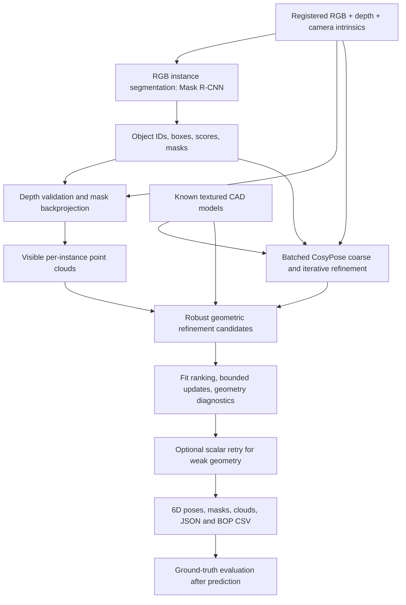

# YCBPose: RGB-D Instance Segmentation and 6D Object Pose Estimation

## 1. Project overview

YCBPose is an implemented perception system that takes a registered RGB-D image and estimates the identities, instance masks, visible point clouds, and six-degree-of-freedom poses of known YCB objects in cluttered scenes. The active project replaces the repository's earlier grasp-planning direction. The Python package is still named `clutterpick` for compatibility.

The project combines pretrained neural perception with depth-based geometric registration. Its strongest measured contributions are a robust CAD-to-depth refinement stage and a more efficient multi-object inference architecture. Additional RGB-D fusion, Transformer mask-head, and learned point-filtering modules have been implemented and evaluated; their results are retained even where they did not improve the baseline.

The current system recognizes 21 known object classes and requires their CAD models. Its output is an object-to-camera pose, rather than a grasp command. Robot control, collision-free grasp execution, and pose estimation for arbitrary unseen objects are outside the implemented scope.

## 2. Inputs, outputs, and coordinate conventions

### Inputs

- An RGB image.
- A depth image registered to the RGB image, with a known raw-value-to-distance scale.
- Camera intrinsics `K`, including focal lengths and principal point.
- CAD models and pretrained checkpoints for the supported object classes.

For the evaluated YCB-V data, images are 640 × 480 pixels and depth is stored as unsigned 16-bit values with a scale of 0.1 mm per raw unit. The implementation converts depth, CAD coordinates, and translations to meters internally.

### Outputs

Each predicted instance can include its class ID, detection score, bounding box, binary mask, camera-coordinate point cloud, aligned CAD geometry, and a homogeneous pose matrix:

```text
T_camera_object = [ R  t ]
                  [ 0  1 ]

p_camera = R * p_object + t
```

The rotation has three degrees of freedom and translation has three. The camera convention is X right, Y down, Z forward. Exported BOP CSV translations are converted back to millimeters and rotations are flattened in row-major order.

Deliverables include segmentation overlays, pose-axis overlays, JSON predictions and diagnostics, BOP-format CSV predictions, per-instance PLY clouds, aligned CAD PLY files, and interactive offline HTML viewers. Point clouds describe visible surfaces; they do not reconstruct hidden geometry.

External registered RGB-D inputs can be processed without ground-truth labels through `scripts/inference/infer_rgbd.py`. This interface still uses the same 21-class recognition vocabulary; generalization to a new camera has not been benchmarked.

## 3. Dataset and evaluation cohorts

| Dataset or cohort | Size | Purpose |
|---|---:|---|
| YCB-V BOP19 test set | 900 frames, 4,125 GT instances, 12 scenes, 21 classes | Full baseline evaluation and paired robust-refinement evaluation |
| PBR training subset | 300 frames from 10 scenes | Training experimental segmentation and point-filtering modules |
| PBR validation subset | 60 frames from 3 separate scenes | Checkpoint and point-classification threshold selection |
| PBR held-out subset | 60 frames from another 3 scenes | Evaluation of the newly trained point-filtering module |
| Real segmentation/architecture cohort | 96 frames, 440 GT instances | Segmentation experiments and inference architecture benchmark |
| Real pose ablation cohort | 24 frames, 110 GT instances | Mask, fusion, and learned-filter pose comparisons |

The full test cohort covers scenes `000048` through `000059`, with 75 frames per scene. The original baseline uses public pretrained checkpoints rather than weights trained locally on the test set.

The research subset is indexed separately from the baseline dataset. Scene separation prevents direct overlap between the new training, validation, and held-out partitions. However, the published pretrained models may already have seen these synthetic PBR scenes during their original training. Consequently, the PBR holdout is independent of the new module training, not necessarily of all pretraining in the complete system.

The real test set has also been inspected during implementation and debugging. These are exploratory implementation evaluations, not claims of a completely untouched final holdout.

### Data integrity

The dataset source is pinned to revision `5c2c4aa229800355648cd268040aa814f8dc94f0`. Full downloaded base, model, and test archives were checked against their published Hugging Face LFS hashes. The smaller PBR subset was obtained using ZIP-member HTTP range requests to avoid downloading the approximately 21 GB archive. Selected members were checked using ZIP CRC and recorded member SHA256 values; the complete PBR archive hash was not verified because the complete archive was not downloaded.

Auditing covers readable images, depth formats and scales, camera metadata, masks, object IDs, target frame lists, duplicate frames, and partition overlap. The extended dataset audit covers 1,320 decoded frames and 12,887 annotated instances.

## 4. Main inference pipeline



### 4.1 Instance segmentation

The main configuration uses the published YCB-V Mask R-CNN with a ResNet-50 backbone and Feature Pyramid Network. It predicts 21 foreground classes plus background. Ordinary inference uses detection-score and mask thresholds of 0.5.

Instance masks define object-specific depth regions. This is important in clutter: a rectangular bounding box often includes the supporting surface, neighboring objects, or background.

### 4.2 Depth backprojection and point-cloud preparation

Pixels inside each predicted mask are converted to camera-coordinate points using:

```text
Z = raw_depth * depth_scale
X = (u - cx) * Z / fx
Y = (v - cy) * Z / fy
```

The evaluated configuration retains depth between 0.1 and 3.0 meters, erodes mask boundaries by one pixel, and downsamples with 3 mm voxels. Boundary erosion reduces mixed pixels near object edges. A minimum of 40 usable points is required for meaningful geometric processing.

The efficient runtime always builds the required instance clouds. It constructs the full scene cloud only when export or visualization requires it.

### 4.3 Neural 6D pose initialization and refinement

The pose backend adapts public CosyPose coarse and refiner checkpoints. The EfficientNet-B3 pose network receives a six-channel representation combining an observed RGB crop and a rendered CAD crop. The evaluated settings use one coarse iteration followed by four refiner iterations.

Object classes, boxes, intrinsics, and CAD renderings are kept aligned throughout batching. Multiple instances of the same class are supported. The optimized configuration processes object instances in chunks of four.

The original crop and pose-update mathematics are retained, while rendering is ported to PyRender on Windows. This renderer differs from the original publication's rendering backend, so the project does not claim an identical reproduction of the paper's benchmark score.

### 4.4 Robust depth refinement

The neural pose is refined using visible depth and the known CAD model. Three candidates are considered:

1. The original neural RGB pose.
2. Trimmed point-to-point ICP.
3. Huber-weighted point-to-plane ICP with damped SE(3) updates.

Candidates are ranked with a common observed-to-model, trimmed Euclidean fit metric. This avoids comparing unrelated objective values between the two ICP methods.

The point-to-point settings include a 40 mm correspondence limit, 80% trimming, and up to 25 iterations. Robust point-to-plane refinement uses up to 20 iterations, a 4 mm Huber threshold, damping of 0.01, and bounded incremental updates.

A depth update must remain within 50 mm translation and 10 degrees rotation of the neural pose and improve the fit by at least 10%. Additional support and coverage checks restrict robust candidates. When geometry cannot justify an update, the system retains the neural pose.

### 4.5 Quality diagnostics and optional retry

Predictions carry geometric-support states such as `supported_geometry`, `weak_geometry`, and `insufficient_depth`. Diagnostics use usable point count, trimmed fit error, coverage, and information about geometric constraints. They provide review information rather than calibrated correctness probabilities.

The optimized configuration can retry a weak-geometry object through the scalar neural path. A retry replaces the batched result only when it has supported geometry, a lower observed fit error, and nondecreasing coverage. This decision does not access GT labels.

Across the final two benchmark repetitions, 72 objects were retried and zero replacements were selected. The measurements therefore do not establish that retry caused the final recall to match the baseline.

## 5. Metrics and how to interpret them

| Metric | Meaning | Interpretation |
|---|---|---|
| Box AP@[.50:.95] | COCO average precision over bounding-box IoU thresholds from 0.50 to 0.95 | Detection localization and class quality |
| Mask AP@[.50:.95] | COCO average precision over instance-mask IoU thresholds | Instance segmentation quality |
| Mask AP50 | Mask AP at IoU 0.50 only | A less strict localization criterion |
| Boundary AP | AP using a boundary-sensitive overlap criterion | Quality of object contours |
| ADD | Mean distance between corresponding CAD points transformed by predicted and GT poses | Pose error for objects without symmetry ambiguity |
| ADD-S | Mean nearest-neighbor distance between the two transformed CAD point sets | Pose error allowing equivalent geometric arrangements |
| ADD(-S) recall@0.1d | Uses ADD-S for classes with symmetry metadata, otherwise ADD; success below 10% of object diameter | Primary diagnostic pose-success metric |
| Point contamination | Mean fraction of retained points outside the visible GT mask, per matched instance | Background inclusion in extracted clouds |
| Foreground retention | Fraction of GT-projected foreground points retained by filtering | Whether cleaning discards useful object points |
| Point precision/recall/F1 | Foreground classification metrics on evaluated ROI points | Quality of the learned point classifier |
| p50/p95 latency | Median and 95th-percentile inference time | Typical and slower-case runtime |
| Throughput | Frames divided by total measured inference time | Average processing rate |

Pose matching uses same-class Hungarian assignment with mask IoU of at least 0.5. The pose recall denominator includes all GT instances, including undetected or unmatched objects. CAD metric computation uses up to 10,000 deterministically sampled vertices.

ADD(-S) is an internal diagnostic metric, not the official BOP average recall based on VSD, MSSD, and MSPD. AP is also not the percentage of images that are entirely correct.

Boundary evaluation combines mask-region and inner-boundary overlap using their minimum, with boundary width approximately 2% of the image diagonal. The query-head experiments change both output resolution and decoder architecture, so the experiments do not isolate attention from resolution.

Contamination is based on projection into visible 2D GT masks. It is not full-volume 3D labeling and excludes unmatched detections from that average. It should be interpreted together with pose recall and foreground retention.

Reported translation errors in the pose evaluator are Euclidean translation errors in millimeters; they should not automatically be called component-wise MAE. A number such as “MAE 11.23” needs its metric definition and units before comparison with these results.

## 6. Full-dataset baseline results

The original pipeline was evaluated on all 900 YCB-V BOP19 frames and 4,125 GT instances.

| Metric | Original pipeline |
|---|---:|
| Box AP@[.50:.95] | 79.33% |
| Mask AP@[.50:.95] | 74.27% |
| Mask AP50 | 96.03% |
| ADD recall@0.1d | 71.98% |
| ADD-S recall@0.1d | 91.08% |
| ADD(-S) recall@0.1d | 86.59% |
| Successful ADD(-S) GT instances | 3,572 / 4,125 |
| Matched GT instances with poses | 3,950 |
| Exported detections/poses | 4,128 |
| Historical median inference, excluding first frame | 1.414 s/frame |

The historical runtime belongs to this original full-dataset run. It is not the sequential control for the later architecture benchmark.

### Why masks and depth matter

The original controlled 24-frame ablation gives:

| Configuration | ADD(-S) recall | Point contamination |
|---|---:|---:|
| Predicted masks + RGB-D pose | 87.27% | 3.94% |
| Bounding boxes + RGB-D pose | 85.45% | 32.64% |
| GT masks + RGB-D pose, oracle experiment | 90.00% | 0.00% |
| Predicted masks + RGB pose, no depth refinement | 82.73% | 3.94% |

On this small cohort, instance masks substantially reduce background points compared with boxes, and depth refinement improves pose recall relative to RGB-only pose estimation. The oracle row uses GT masks explicitly and is not a deployable inference configuration.

## 7. Improvement A: robust geometric refinement

The robust extension was evaluated by replaying the same cached detector outputs and neural poses on all 900 frames. This keeps the upstream predictions fixed while testing geometric refinement.

| Pose metric | Original refinement | Robust refinement |
|---|---:|---:|
| ADD recall@0.1d | 71.98% | 74.33% |
| ADD-S recall@0.1d | 91.08% | 91.66% |
| ADD(-S) recall@0.1d | 86.59% | 88.80% |
| Successful ADD(-S) instances | 3,572 | 3,663 |

The primary result is **+2.21 percentage points of ADD(-S) recall**, with 91 GT instances changing from fail to pass and zero changing from pass to fail at the chosen threshold. This does not imply every numerical pose error decreased.

The selected candidate counts were 2,570 robust point-to-plane, 1,053 trimmed point-to-point, and 505 original RGB poses. This demonstrates that fallback and complementary geometric candidates remain useful.

Synthetic CAD corruption tests also exercised partial observations, outliers, depth noise, and initialization errors:

| Synthetic test | Cases | Original mean ADD | Robust mean ADD |
|---|---:|---:|---:|
| Seed 137 | 63 | 8.56 mm | 6.03 mm |
| Held-out seed 271 | 63 | 10.70 mm | 6.09 mm |

The held-out seed uses the same 21 objects, not unseen identities. It supports robustness under the tested synthetic perturbations and does not substitute for a new real-camera benchmark.

The `supported_geometry` group had diagnostic precision of 98.27% on the full replay. That is a measured group statistic, not a calibrated confidence guarantee; wrong identities and symmetry ambiguities can still fit observed geometry.

## 8. Improvement B: multi-object inference architecture

The runtime redesign preserves the strong public segmentation and pose checkpoints and uses the robust refinement stage. It changes execution and resource reuse:

- **Batched pose estimation:** runs coarse/refiner computations on multiple instances together, with a batch size of four.
- **GPU-resident CAD rendering:** retains a renderer scene, camera, light, and object nodes, hiding inactive objects instead of removing and re-uploading meshes.
- **Cached spatial indices:** reuses immutable class-specific CAD KD-trees across frames and refinement candidates.
- **On-demand scene geometry:** skips full scene-cloud construction when no export or visualization needs it.
- **Optional quality-aware retry:** reevaluates only weak-geometry objects through the scalar path under the same acceptance bounds.

### Measured architecture result

The expanded benchmark uses 96 fixed frames and 440 GT instances on an NVIDIA RTX 4060 Laptop GPU. Each variant receives a 96-frame warm-up followed by two measured repetitions. Timings cover inference before GT scoring and exclude model initialization and report visualization.

| Metric | Sequential robust control | Optimized, quality gate enabled |
|---|---:|---:|
| Median latency | 1.901 s | 1.190 s |
| p95 latency | 3.122 s | 2.002 s |
| Throughput | 0.508 frames/s | 0.815 frames/s |
| ADD(-S), repetition 1 | 88.64% | 88.64% |
| ADD(-S), repetition 2 | 88.64% | 88.64% |

This corresponds to **37.4% lower median latency**, **35.9% lower p95 latency**, and **1.60× throughput**. Both measured repetitions retain 390 successful GT instances out of 440, with no paired success-threshold gains or losses.

The fast configuration without scalar retry measured 0.759 s median latency and 1.027 s p95. Its recall was 88.64% and 88.41% across the two repetitions: one pass-to-fail change occurred in the second repetition. A small numerical pose difference crossed the hard 10-degree refinement acceptance boundary for a banana instance, causing a different fallback outcome. The fastest profile therefore cannot be described as having demonstrated regression-free accuracy.

The final quality-enabled run reused the sequential control report and ran the optimized process later. Variants were not interleaved, so thermal state and background load are not fully controlled. Because zero retry replacements were selected, the final recall match should not be attributed causally to retry.

### Component ablation

The earlier 24-frame component pilot had the same 88.18% recall in both repetitions for every listed variant:

| Variant | Median latency | p95 latency |
|---|---:|---:|
| Sequential control | 1.825 s | 2.743 s |
| Batch only | 1.896 s | 2.453 s |
| Cache only | 1.792 s | 2.705 s |
| Batch + cache + lazy geometry, initial implementation | 1.467 s | 1.969 s |
| Resident renderer only, measured in a later phase | 1.732 s | 2.851 s |

Batching alone did not improve median latency in this pilot. The integrated architecture result is stronger than a claim that every individual component independently improves every runtime metric.

### Renderer and memory validation

The resident renderer was checked against the legacy rendering path across multiple CAD classes. Silhouettes and depth were identical in the measured controls. Sparse RGB differences were at most one uint8 level, also observed in a legacy-repeat control; bitwise RGB equality is not claimed.

After warm-up, the final optimized benchmark recorded zero mesh-context additions versus 864 for the sequential control. Reported peak Torch allocation was approximately 417.3 MiB versus 411.6 MiB. These values exclude OpenGL and driver allocations; the project does not claim lower total VRAM usage.

## 9. Experimental learned architecture improvements

Three additional directions are implemented and retained as research configurations.

### 9.1 RGB-D fusion segmentation

The experiments compare RGB-only fine-tuning, four-channel early fusion, two-branch late FPN fusion, and gated mid-level fusion. Depth is normalized metric scalar depth; the depth branch repeats the scalar channel to reuse RGB initialization. Gated fusion uses learned residual gates at backbone levels before FPN, rather than cross-modal self-attention.

All six segmentation variants use the same four-epoch, 300-frame PBR budget. Training includes whole-depth dropout, pixel dropout, and millimeter-scale depth noise. Checkpoints are selected by validation mask AP.

### 9.2 CNN–Transformer mask head

The custom query-based mask head pools 28 × 28 ROI features and uses a lightweight spatial-query Transformer decoder with four attention heads. Its output is 56 × 56 masks. It is not the official PointRend implementation.

The design tests a hybrid CNN–Transformer mask architecture, but the current experiments jointly change decoder and resolution. A fixed-resolution control would be needed to identify the separate benefit of attention.

### 9.3 Learned 3D foreground filtering

A class-conditioned local point-attention network predicts foreground/background probabilities before ICP. Features include position, color, original mask membership, absolute depth, and local neighborhood information. It uses 16-point neighborhoods, local attention, global aggregation, and class embeddings.

Supervision is derived from visible GT masks projected onto actual depth observations. Training uses matched detector ROIs with surrounding points; it is not full-scene volumetric 3D supervision. The network is trained for 20 epochs, and the selected checkpoint is epoch 19. Its foreground threshold of 0.3 is selected on validation. A fallback retains the original cloud if fewer than 40 points or less than 25% of the cloud would remain.

### Real-image segmentation and pose results

Mask and boundary AP below use 96 frames. Pose recall and contamination use the separate 24-frame / 110-GT cohort with robust ICP.

| Variant | Mask AP | Boundary AP | ADD(-S) recall | Contamination |
|---|---:|---:|---:|---:|
| Published RGB detector | 74.24% | 47.24% | 88.18% | 3.94% |
| RGB fine-tuning | 72.34% | 45.74% | 87.27% | 4.22% |
| Early fusion | 72.36% | 43.89% | 89.09% | 4.06% |
| Late fusion | 70.92% | 43.63% | 88.18% | 4.29% |
| Gated fusion | 70.11% | 41.93% | 89.09% | 3.80% |
| RGB + query head | 69.91% | 41.40% | 89.09% | 4.49% |
| Gated fusion + query head | 69.66% | 40.83% | 87.27% | 4.13% |

All locally fine-tuned segmentation variants have lower real-image mask AP than the published detector. The modest pose differences are based on only 110 GT instances and do not establish a general improvement.

The RGB query head improved synthetic validation mask AP from 74.28% to 74.99% and boundary AP from 61.10% to 62.71%, but this did not transfer to the real test cohort. Limited PBR-only training, domain mismatch, and forgetting are plausible explanations; the experiments do not isolate which explanation is responsible.

### Point-network results

On 882 matched held-out PBR ROI examples:

| Classifier | Precision | Recall | F1 | Contamination |
|---|---:|---:|---:|---:|
| Original predicted-mask membership | 89.34% | 92.82% | 91.04% | 10.66% |
| Learned point filter | 96.15% | 96.22% | 96.18% | 3.85% |

These metrics are conditional on matched ROI proposals; they are not whole-scene 3D segmentation accuracy.

With the same published RGB detector on real images, the filter reduces contamination from 3.94% to 3.16%, retaining an average of 94.79% of projected foreground points. ADD(-S) remains 88.18%, with zero paired threshold gains or losses. Cleaner clouds therefore did not translate into demonstrated pose-recall improvement on this cohort.

The combined gated-fusion, query-head, point-filter, and robust-ICP pipeline achieves 88.18% ADD(-S) and 3.36% contamination on the 24-frame cohort. It remains experimental rather than the recommended accuracy baseline.

### Depth robustness experiment

The first four variants were evaluated with all depth missing, 30% or 80% pixel dropout, and 5 mm depth noise. RGB-only AP remains unchanged by construction. Early, late, and gated fusion show relatively small AP changes, but do not outperform the published RGB baseline overall. These perturbations affect the segmentation depth input only; they are not end-to-end pose robustness tests.

## 10. Validation, reproducibility, and project structure

The recorded delivery includes 30 passing automated tests and successful baseline, extension, research, and architecture validation reports. Checks cover geometry, units, rotation validity, prediction provenance, matching and metrics, cached-tree equivalence, renderer behavior, batching, and output contracts. The optimized demo exports valid poses and visualization artifacts.

Prediction occurs before GT evaluation. GT poses are not supplied to the inference backend. GT masks are used for supervised training, validation, scoring, and explicitly marked oracle ablations. A geometrically valid finite pose is not automatically an accurate pose.

The source and pretrained assets are recorded in manifests. CosyPose source is pinned to commit `c90a04f434b1e89f02341cc03899eb63ea8facba`. Checkpoint hashes recorded after download provide local consistency checks rather than publisher-authenticated signatures.

| Location | Role |
|---|---|
| `src/clutterpick/` | Dataset access, detection, fusion, point network, geometry, pose, refinement, pipeline, evaluation, reporting |
| `configs/default.yaml` | Original baseline |
| `configs/enhanced.yaml` | Sequential robust refinement |
| `configs/optimized.yaml` | Efficient inference with quality retry enabled |
| `configs/optimized_fast.yaml` | Efficient inference without scalar retry |
| `configs/hybrid.yaml` | Experimental learned fusion, query mask head, and point filter |
| `configs/point_refined.yaml` | Published detector with learned point filtering |
| `scripts/` | Dataset preparation, training, inference, benchmarks, report builders, validators, viewers |
| `reports/ycbv/` | Full baseline metrics and delivery validation |
| `reports/ycbv/extension/` | Robust-refinement comparison and synthetic tests |
| `reports/ycbv/research/` | Learned-module ablations and validation |
| `reports/ycbv/architecture/` | Runtime benchmarks, renderer checks, paired accuracy, delivery validation |

The tested environment is Windows, Python 3.11, PyTorch with CUDA, and an RTX 4060 Laptop GPU with 8 GB VRAM. Core tools include torchvision, NumPy, SciPy, PyRender, trimesh, pycocotools, Plotly, and pytest. CPU inference is exposed by the CLI but has not been benchmarked.

### Example optimized inference

```powershell
.\.venv\Scripts\python.exe main.py --config configs/optimized.yaml infer --frame-key ycbv_test/000048/1074 --output artifacts/ycbv/architecture/demo
```

Full reproduction entry points are `scripts/workflows/run_all.ps1`, `scripts/workflows/run_extension.ps1`, `scripts/workflows/run_research.ps1`, and `scripts/workflows/run_architecture.ps1`. These rerun substantial evaluations; existing reports can be inspected without rerunning them.

## 11. What the project demonstrates

The project demonstrates integration of 2D instance segmentation, calibrated RGB-D geometry, neural render-and-compare pose estimation, robust registration, multi-object GPU execution, reproducible evaluation, and interactive inspection tools.

Its measured accuracy improvement comes from robust geometric refinement: 86.59% to 88.80% ADD(-S) on the full 900-frame diagnostic evaluation. Its measured runtime improvement comes from the inference architecture: 37.4% lower median latency while retaining 88.64% ADD(-S) recall in both repetitions of the separate 96-frame benchmark.

The learned architecture work demonstrates implemented ablations and point-cloud cleaning, but does not establish a stronger real-image detector or improved real-image pose recall. Those findings are useful evidence for the final decision to keep the published detector in the main optimized pipeline.

Remaining limitations include known-object dependence, sensitivity to occlusion and masks, dependence on registered depth and camera calibration, different rendering behavior from the original publication, exploratory test use, and the absence of official BOP AR, fresh-camera testing, or robot execution validation. The measured processing rate does not support a real-time claim.

## 12. Suggested CV wording

> Built an RGB-D perception pipeline for 21 known YCB objects using instance segmentation, point-cloud extraction, and 6D pose estimation; improved diagnostic ADD(-S) recall from 86.59% to 88.80% on 900 YCB-V frames through robust depth refinement.

> Re-architected multi-object inference with batched pose estimation, GPU-resident CAD rendering, cached spatial indices, and on-demand scene geometry; reduced median latency by 37.4% and p95 latency by 35.9% on 96 YCB-V frames, retaining 88.64% ADD(-S) recall across two measured repetitions.

These statements describe the measured project contributions without implying training the published backbone from scratch, state-of-the-art performance, official BOP ranking, or robot grasp success.

## 13. Primary local evidence

- [Full baseline measurements](reports/ycbv/measured_summary.json)
- [Baseline delivery validation](reports/ycbv/delivery_validation.json)
- [Robust refinement results](reports/ycbv/extension/RESULTS_VI.md)
- [Learned-module results](reports/ycbv/research/RESULTS_VI.md)
- [Architecture results and limitations](reports/ycbv/architecture/RESULTS_VI.md)
- [Architecture measured summary](reports/ycbv/architecture/measured_summary.json)
- [Renderer validation](reports/ycbv/architecture/renderer_validation.json)
- [Inference architecture design](docs/INFERENCE_ARCHITECTURE_VI.md)
- [Third-party sources and licenses](docs/THIRD_PARTY.md)

This summary documents existing measurements. Writing this file did not rerun training or the benchmarks.
