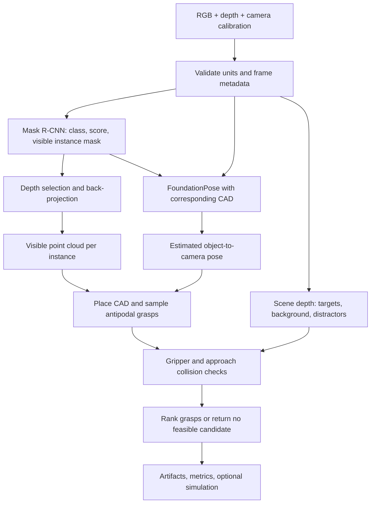

# Đánh giá khả thi và pipeline đề xuất

Ngày kiểm tra: 12/10/2026. Dataset revision: `39e2ccc49f7a3e258eab5cec84749c5817df417a`.

**Kết luận: Có thể triển khai dự án trên IndustryShapes, với phạm vi perception → pose → grasp hình học và collision filtering. Dataset đủ để huấn luyện instance segmentation và đánh giá pose; chưa đủ để khẳng định tỷ lệ gắp thành công, khả năng tiếp cận của robot hoặc an toàn vật lý.**

## 1. Phạm vi kiểm tra đã thực hiện

Đã đọc đặc tả người dùng, website, paper, dataset card, benchmark repository, adapter FoundationPose của tác giả và tài liệu BOP. Đã trực tiếp đọc directory của cả 8 ZIP bằng HTTP Range, toàn bộ `scene_gt.json`, `scene_camera.json`, `scene_gt_info.json` của Classic, Extended và Onboarding; đọc các JSON của scene đầu tiên trong mỗi gói PBR. Đã giải mã 6 frame đại diện, mỗi frame gồm RGB, depth, mask và mask_visib của instance đầu tiên; kiểm tra CRC khi đọc các file này; giải mã CAD vertices và back-project point cloud.

**Chưa kiểm tra toàn bộ nội dung pixel, checksum đầy đủ của ZIP, ảnh trùng lặp hoặc tất cả annotation PBR. Chưa train detector, chạy FoundationPose, sinh grasp hay mô phỏng robot.** Các point cloud trong `samples/` dùng ground-truth mask để kiểm tra dữ liệu, không phải kết quả suy luận của mô hình.

Nguồn bằng chứng máy đọc: `audit_summary.json`, các `*_manifest.json`, `geometry_smoke_checks.json`, `samples/*/sample_audit.json`. Script tái kiểm tra: `inspect_industryshapes.py`, `check_geometry.py`.

## 2. Dataset có những gì?

Các số sau được đếm trực tiếp từ BOP JSON hoặc directory ZIP:

| Nhóm | Scene / sequence | Frame có annotation | Instance có annotation | Vai trò đề xuất |
|---|---:|---:|---:|---|
| Classic Train | 13 | 3.700 | 3.913 | Baseline train và validation theo scene |
| Classic Test | 8 | 923 | 1.931 | Test chính, khóa từ đầu |
| Onboarding | 10 | 6.309 | 6.309 | Thí nghiệm bổ sung / model-free, không mặc định trộn vào baseline |
| Extended Test | 3 | 2.080 | 10.316 | Test chuyển miền camera và bối cảnh |
| PBR Upright | 10 | 10.000 file RGB | 50.000 file mask | Bổ sung train tổng hợp; cần audit labels toàn bộ |
| PBR Random | 21 | 21.000 file RGB | 104.975 file mask | Bổ sung train tổng hợp; cần audit labels toàn bộ |

Đối với hai gói PBR, số ở bảng là đếm file, không phải kết quả xác minh toàn bộ instance JSON. Scene đầu tiên của mỗi gói có 1.000 frame, 5.000 annotation và các mask tương ứng. Các nhóm không phải PBR cộng lại có 13.012 frame được gán nhãn và 22.469 instance. Không được đồng nhất số instance với số ảnh.

Dataset có 5 object ID. Có RGB, depth, camera intrinsics, depth scale, object-to-camera pose, CAD PLY/OBJ, bounding box đầy đủ và bounding box vùng nhìn thấy trong BOP GT info, mask đầy đủ và mask visible, cùng visibility fraction. Cấu trúc và quy ước được mô tả trong [tài liệu BOP](https://github.com/thodan/bop_toolkit/blob/master/docs/bop_datasets_format.md).

`mask` là silhouette chiếu của mô hình đầy đủ, có thể bao gồm vùng bị vật khác che; `mask_visib` là vùng visible. Với Mask R-CNN thông thường và việc chọn depth, sử dụng `mask_visib`. Không dùng depth nằm trong phần bị che của full mask để gán cho vật đích.

Không tìm thấy grasp ground truth, nhãn force closure, URDF robot/gripper, robot-base calibration, thuộc tính vật lý hoặc nhãn point-wise cho toàn bộ bề mặt 3D trong các archive đã kiểm tra. Nhãn 3D của điểm nhìn thấy có thể suy ra từ visible mask và depth, nhưng không phải ground truth của bề mặt khuất.

Hugging Face cung cấp 10.222 train rows và 12.247 test rows. Benchmark giải thích rằng một row ứng với một object pose; train gộp Classic Train với Onboarding, test gộp Classic Test với Extended Test. Vì vậy, loader detection phải gom toàn bộ instance cùng frame, giữ được nhiều instance cùng class. Chọn BOP làm nguồn chính để tránh lặp RGB/depth và giữ rõ nhóm dữ liệu. [Dataset card](https://huggingface.co/datasets/POSE-Lab/IndustryShapes/blob/main/README.md), [benchmark README](https://github.com/POSE-Lab/IndustryShapes_benchmark).

## 3. Các vấn đề cần xử lý trước khi train

### Domain shift và lớp không cân bằng

Classic Train chỉ có 213/3.700 frame chứa nhiều instance và không có frame chứa nhiều instance cùng class trong annotation đã kiểm tra. Classic Test có 849/923 frame nhiều instance; Extended Test có 2.080/2.080. Đây là rủi ro chính cho nghiên cứu occlusion: detector học chủ yếu từ vật đơn, rồi test trên cảnh phức tạp.

Số instance Classic Train theo object 1→5 là 640, 869, 1.574, 508, 322. Cần báo cáo per-class AP và điều chỉnh sampler trên train. Nên có hai cấu hình riêng: Classic-only và Classic+PBR. Không trộn dữ liệu tổng hợp rồi gọi kết quả là baseline Classic-only. Dữ liệu PBR hiện có giúp giảm nhu cầu tự dựng toàn bộ bộ train tổng hợp, nhưng phải kiểm tra chất lượng, số lượng instance cùng class và phân bố visibility trước khi sử dụng.

Dataset phù hợp với vật công nghiệp trong cảnh assembly có clutter; không đại diện đầy đủ cho mọi dạng bin-picking dày đặc. Chỉ 5 object nên khả năng tổng quát sang vật mới phải được xem là nghiên cứu bổ sung. Paper mô tả rõ mục tiêu assembly và khác biệt giữa train/test. [Paper chính thức](https://arxiv.org/html/2602.05555v1).

### Depth và hình học

Mẫu Classic dùng depth scale 1, mẫu Extended/Onboarding/PBR dùng 0,1. Công thức chuyển sang mét: `Z_m = raw_depth * depth_scale / 1000`. Giữ nguyên uint16 khi đọc; raw depth bằng 0 được loại khỏi back-projection. Không dùng một scale cố định cho mọi nhóm.

Các mẫu Classic/Extended/Onboarding đã đọc có RGB và depth cùng kích thước 640×480. Mẫu PBR có độ phân giải khác; loader phải đọc kích thước từng frame, không hard-code. Resize/crop hình phải cập nhật intrinsics tương ứng; resize masks bằng nearest-neighbor.

Mẫu Classic Test có 9.484 điểm visible với depth hợp lệ; 4,37% pixel visible bị thiếu depth. Median khoảng cách điểm đến CAD vertex gần nhất sau khi đặt CAD bằng GT pose là 3,04 mm; mẫu Extended là 8,65 mm, percentile 95 là 33,27 mm. Đây là kiểm tra tính nhất quán trên vài mẫu, không phải sai số pose do mô hình dự đoán hoặc độ chính xác toàn dataset. Không chọn clearance va chạm nhỏ hơn mức bất định hình học chỉ vì ảnh trông khớp.

### Annotation pose và symmetry

Có 82 annotation Classic Train với `||R.T R - I||_F > 1e-3`, thuộc object 2 ở scene 000004, 000005, 000006, 000008. Sai lệch lớn nhất khoảng 0,0849; determinant lớn nhất khoảng 1,0429. Đây là cảnh báo chất lượng/convention cần điều tra, không kết luận mọi annotation này đều hỏng. Giữ nguyên annotation gốc, lập danh sách frame/instance bị đánh dấu, kiểm tra reprojection/CAD-depth và ghi rõ chính sách xử lý. Không âm thầm sửa GT dùng trong benchmark. Nếu cần chuẩn hóa rotation để train, chỉ tạo bản dẫn xuất với provenance và đối chiếu baseline gốc.

`models_info.json` có diameter và kích thước nhưng không khai báo `symmetries_discrete` hoặc `symmetries_continuous`, dù đối xứng là đặc tính dataset được tác giả đề cập. Có thể tính ADD, ADD-S như chẩn đoán có mô tả; không mặc định coi metrics MSSD/MSPD là symmetry-aware đúng cho dataset khi chưa xác minh định nghĩa symmetry từ benchmark. Rotation error cũng cần xử lý ambiguity đối xứng.

### File dư và split

Trong Onboarding có 268 RGB và 482 depth không có GT tương ứng, cùng một mask dư. Loader supervised nên duyệt khóa frame có trong GT và kiểm tra các file đi kèm; không ghép hai danh sách file theo thứ tự. Không phát hiện thiếu RGB/depth/camera hoặc thiếu mask/mask_visib cho các GT frame đã audit, gồm toàn bộ nhóm không PBR và scene PBR được kiểm tra. Điều này không đảm bảo tất cả ảnh đều không bị lỗi pixel.

Khóa dữ liệu nên là `(source_group, scene_id, image_id, instance_index)`, không chỉ object ID; scene ID có thể được tái sử dụng giữa các nhóm. Khóa frame dùng ba trường đầu. Giữ test chính thức; tạo validation từ scene train sao cho cả train và val vẫn có đủ class. Object 3 chỉ xuất hiện ở hai scene Classic Train, nên cần đặc biệt tránh holdout làm mất dữ liệu real hoặc synthetic của lớp này mà không ghi nhận. Manifest split phải công khai và cố định trước thí nghiệm.

## 4. Môi trường hiện tại và tính khả thi triển khai

Đã kiểm tra máy local:

- GPU: NVIDIA GeForce RTX 4060 Laptop, 8.188 MiB VRAM.
- RAM: khoảng 15,7 GiB.
- Python: 3.11; PyTorch: `2.10.0+cpu`; `torch.cuda.is_available()` trả False.
- NumPy, Pillow, requests, SciPy, PyArrow và Hugging Face Hub đã có; Open3D chưa có.
- WSL2 có đăng ký Ubuntu nhưng không khởi chạy được do đường dẫn `ext4.vhdx` không tồn tại. Docker CLI đã có nhưng không kết nối được Docker Engine.
- D còn khoảng 76,2 GB theo hệ thập phân, C còn khoảng 22,6 GB tại thời điểm kiểm tra.

Đánh giá kỹ thuật: GPU phù hợp để bắt đầu fine-tune Mask R-CNN với batch nhỏ, AMP và gradient accumulation; batch và thời gian train phải đo thực tế. FoundationPose có CUDA/C++ dependencies, renderer và tài liệu Docker; nên chạy Linux/WSL2 hoặc máy Linux GPU đã cấu hình. 8 GB không đảm bảo mọi cấu hình pose chạy được: cần smoke test một object, giảm số hypothesis/batch khi phù hợp và đo peak VRAM trước khi chạy toàn bộ. [FoundationPose chính thức](https://github.com/NVlabs/FoundationPose), [adapter IndustryShapes](https://github.com/POSE-Lab/FoundationPose_IS).

Không sửa môi trường hệ thống trong đợt audit này. Cần tạo môi trường riêng cho detector và pose để tránh xung đột thư viện. Nếu WSL/Docker chưa sửa được, vẫn triển khai data, segmentation và geometry trên Windows; dùng môi trường Linux GPU riêng cho pose. Phần này là điều kiện triển khai cụ thể, không phải thiếu dữ liệu.

Tổng archive không PBR khoảng 6,77 GB nén; Classic Train+Test+CAD PLY khoảng 1,76 GB. Toàn bộ 8 archive khoảng 34,50 GB nén và 35,63 GB giải nén, chưa tính môi trường, checkpoint và cache. Không tải đồng thời tất cả ZIP, Parquet và cache lên C. Bắt đầu Classic+CAD trên D, bổ sung PBR theo giai đoạn. Nên dự trù tối thiểu khoảng 100 GB trống nếu giữ cả ZIP, dữ liệu giải nén, environment và thí nghiệm đầy đủ; đây là ngân sách đề xuất.

## 5. Pipeline triển khai chi tiết

### Bước 1 — Loader và audit đầy đủ trước train

Chuẩn hóa source groups; parse BOP; lập frame index; tạo scene-level validation; kiểm tra file hỏng, duplicate hashes, depth bit depth và GT instance correspondence. Hoàn tất audit toàn bộ PBR nếu sử dụng. Sinh báo cáo thống kê class/visibility, overlay RGB-mask và CAD-GT-depth.

Đầu ra: `dataset_manifest.json`, split manifests và data audit report. Điều kiện qua bước: unit/convention xác minh trên mẫu nhiều nhóm, tất cả GT training frames được đọc hoặc có danh sách exclusion minh bạch.

### Bước 2 — Instance segmentation baseline

Fine-tune Mask R-CNN backbone ResNet-50/FPN pretrained; 5 foreground classes + background. Train visible masks, lấy bbox từ visible mask hoặc `bbox_visib` nhất quán. Freeze một phần backbone giai đoạn đầu nếu cần cho VRAM; chọn lịch train và augment bằng validation. Không resize depth/camera theo augmentation RGB mà quên cập nhật calibration khi đánh giá downstream.

Đầu ra: checkpoint, detection JSON và predicted instance masks. Đánh giá box AP, mask AP, per-class AP, latency và nhóm visibility. Match prediction↔GT instance bằng class/IoU để gán visibility; instance bị miss vẫn phải tính vào denominator, không chỉ phân tích các object detect thành công.

Sau khi baseline hoạt động, thêm YOLO segmentation với cùng split và ngân sách công bố. Deformable DETR có mask head tương thích chỉ là mở rộng, không bắt buộc cho MVP.

### Bước 3 — RGB-D geometry

Chọn `predicted_mask AND valid_depth`; back-project bằng K và scale từng frame. Giữ camera frame theo convention BOP; xuất toàn bộ đơn vị mét. Đo số điểm giữ lại, phần depth thiếu và contamination so với GT visible mask. Có thể dùng erosion nhẹ gần boundary, voxel downsampling và outlier removal; ghi cấu hình và số điểm trước/sau.

Đầu ra: point cloud từng instance và scene cloud. Đây là tái dựng phần nhìn thấy, không phải hoàn thiện toàn bộ hình dạng khuất. Không loại background/distractor khỏi scene cloud dùng cho collision chỉ vì detector không phân loại chúng.

### Bước 4 — Pose 6-DoF

Ưu tiên FoundationPose model-based với RGB, depth, K, predicted instance mask và CAD đúng class. Lần đầu dùng GT mask chỉ để smoke test pose/conventions; sau đó thay bằng predicted mask. Adapter chính thức đang đọc `mask_visib` qua GT entries trong patch, vì vậy không lấy số benchmark của adapter làm kết quả end-to-end detector. Cần adapter mới nhận predictions và bảo toàn nhiều instance cùng class. [Patch adapter](https://github.com/POSE-Lab/FoundationPose_IS/blob/main/diff.patch).

Kiểm tra CAD scale/origin và output transform trước khi đánh giá. Nếu mesh được center nội bộ phải chuyển pose về frame CAD gốc. ICP chỉ dùng refine pose đã khởi tạo đáng tin cậy, không coi PCA hoặc ICP từ identity là lời giải pose 6D tổng quát dưới occlusion. Cache model geometry, xử lý instance tuần tự để giảm VRAM.

Đầu ra: pose, confidence và failure status cho từng detection. Đánh giá ADD/ADD-S theo định nghĩa đã chốt, translation/rotation diagnostics và BOP metrics phù hợp. Báo cáo conditional pose accuracy trên instance matched và end-to-end recall gồm missed detections. Không dùng pose GT cho inference hoặc warm-start trừ experiment oracle được ghi rõ.

### Bước 5 — Grasp hình học theo CAD

Xác định gripper parallel-jaw bằng tham số opening tối đa, finger geometry, palm geometry, contact tolerance và approach length. Sample cặp contact/normals trên CAD để tạo antipodal candidates, với friction coefficient giả định được ghi trong config. Đặt candidate vào camera frame bằng estimated object pose. Sàng lọc width, contact geometry và khả năng approach; giữ observed point cloud để kiểm tra tính phù hợp với quan sát.

Đầu ra: `T_camera_gripper`, opening width, approach vector và geometric score. Object lớn không nhất thiết đòi opening bằng đường kính: cần kiểm tra vùng tiếp xúc cục bộ. Một số vật hoặc viewpoint có thể không có grasp khả thi; đây là output hợp lệ. CAD giúp mô hình hóa phần khuất của vật đã nhận dạng, nhưng phụ thuộc sai số pose và độ khớp CAD.

### Bước 6 — Collision và ranking

Kiểm tra thể tích fingers/palm ở pregrasp, trên quỹ đạo approach và khi đóng gripper. Phân biệt intended contact với penetration ngoài vùng contact. Dùng toàn scene depth cho obstacles; dùng CAD của các object được ước lượng pose để bổ sung geometry phần khuất khi đáng tin cậy. Áp dụng margin theo bất định depth/pose, bảo tồn vùng unknown thay vì mặc định coi là rỗng.

Rank bằng contact score, clearance và accessibility; weight chọn trên validation. Đầu ra top-k và rejection reasons, hoặc `no_feasible_grasp`. Đây là collision filtering dưới mô hình scene hiện có; không đảm bảo an toàn tuyệt đối ở vùng khuất. Chỉ thêm IK/workspace/robot-link collision khi có robot URDF và camera-to-base calibration.

### Bước 7 — Đánh giá và mô phỏng tùy chọn

Thiết lập cảnh mô phỏng từ CAD, gripper và các giả định mass/friction/inertia được công bố. Nếu thiếu geometry thực của holder/bin/background, gọi đó là cảnh proxy, không khẳng định đã tái tạo vật lý chính xác ảnh dataset. Success criterion nên yêu cầu kẹp, nhấc và giữ vật trong thời gian/quãng đường quy định. Báo cáo chỉ là simulated success.

Xuất `detection.json`, masks, pointclouds, `poses.json`, `grasps.json`, rejection reasons, timing và visualization. Mỗi artifact ghi frame, source group, units, checkpoint/config hash và whether GT was used.

## 6. Thiết kế thí nghiệm nên giữ

1. Mask R-CNN vs YOLO segmentation: cùng scene split; box/mask AP; per-class và visibility; latency và peak VRAM.
2. Bbox depth vs predicted mask depth vs GT visible mask: contamination, point count, pose errors và grasp availability. GT mask là oracle diagnostic.
3. Classic-only vs Classic+PBR: đo cải thiện ở Classic Test và chuyển miền ở Extended Test; công bố dữ liệu bổ sung.
4. Collision bật/tắt: đánh giá bằng mesh/scene tham chiếu độc lập hoặc simulator. Không dùng chính bộ lọc để tự chứng minh collision rate sau lọc giảm về 0.
5. Error propagation: mask → pose → collision/grasp; gồm failed detections và failed pose. Báo cáo tỷ lệ scene có candidate và tỷ lệ gắp thành công như hai phép đo riêng.
6. RGB vs RGB-D: chỉ làm khi đã có hai cấu hình pose tương thích và giải thích yếu tố bị thay đổi. Với known CAD, RGB có thể ước lượng scale qua pose method; nếu grasp/collision vẫn dùng depth thì đó là RGB-pose vs RGB-D-pose, không phải toàn pipeline RGB-only. Khi so hai model khác kiến trúc phải công bố yếu tố nhiễu, không quy mọi chênh lệch cho depth.

Latency đo end-to-end, tách preprocessing/segmentation/pose/grasp/collision; sync GPU khi đo, warm-up và công bố số object mỗi frame. Multi-view liên tiếp cùng scene không được xem là nhiều scene độc lập khi tính khoảng tin cậy.

## 7. Phạm vi và thứ tự ưu tiên

MVP: BOP loader + Mask R-CNN + visible RGB-D cloud + pose method có sẵn + CAD grasp candidates + collision filtering + báo cáo. Tiếp theo: YOLO comparison và PBR ablation. Cuối cùng: simulation, model-free onboarding, learned grasp, Deformable DETR hoặc PointNet++.

Các mốc acceptance quan trọng: data smoke test có geometry khớp; detector có AP đo được trên split khóa; pose chạy với predicted masks không cần GT; grasp/collision xuất được rejection reasons và kiểm chứng độc lập. Có thể bắt đầu bằng 50–100 frame đại diện đủ 5 lớp để kiểm tra runtime/VRAM và failure modes, rồi mới train/chạy toàn bộ.

Tôi có thể triển khai các module, adapter và experiment scripts trong phạm vi này. Chưa có căn cứ để hứa accuracy, realtime hoặc tỷ lệ grasp success. Trở ngại hiện tại là môi trường GPU/pose và các điểm audit cần hoàn tất, không phải dataset thiếu nền tảng cho perception.
