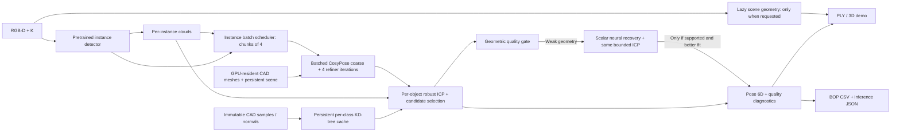

# YCBPose: kiến trúc suy luận đa vật thể

Giữ bài toán YCB-V RGB-D instance segmentation → point cloud → 6D pose. Detector pretrained và CosyPose coarse/refiner giữ nguyên weights. Không dùng các fusion/query heads đã làm giảm chất lượng trên ảnh thật. Bản mới thay cách tổ chức inference và quản lý hình học, không nhận batching hoặc KD-tree caching là thuật toán mới.



## Thay đổi kiến trúc

1. **Multi-instance scheduling:** tạo instance clouds trước, gom box/class/point inputs theo thứ tự detection. Các vật cùng class vẫn là instances riêng. GPU chạy coarse/refiner theo chunks tối đa bốn objects; CPU robust ICP và diagnostics giữ riêng từng object. Mesh DB/crop/render/pose-update sử dụng implementation đã ghim từ CosyPose.
2. **CAD index caching:** mỗi class có một KD-tree từ CAD samples bất biến, tái dùng qua các instances và frames. Các candidates và fit metrics dùng cùng index. Test kiểm cached/uncached cho transform và diagnostics giống hệt, đồng thời kiểm cache của hai object IDs không lẫn nhau.
3. **Lazy scene reconstruction:** khi không yêu cầu PLY hoặc 3D plots, bỏ backprojection/voxel của toàn scene. Instance point clouds phục vụ ICP vẫn được tạo. Demo yêu cầu scene clouds vẫn xuất đầy đủ.
4. **Resident renderer:** giữ một scene, camera, light và node theo class. Mesh không được chọn bị ẩn nhưng vẫn ở GPU context; tránh upload/remove buffers mỗi khi chuyển object trong neural batch. Cập nhật pose và intrinsics trước mỗi render, luôn ẩn mesh sau render. Pixel equivalence test đối chiếu với scene cũ trên cùng poses/K, gồm chuyển class và lặp class.
5. **Quality-aware recovery:** nếu batch pose sau ICP có `weak_geometry`, chạy lại riêng object với cùng weights/iterations. Chỉ thay pose nếu geometry trở thành supported, RMSE thấp hơn và coverage không giảm. Không chạy lại khi chỉ thiếu depth; không nới bounds 50 mm / 10°. Gate dùng các thresholds geometry đã có, không dùng GT. Recovery là workload bổ sung nên được đo lại latency/recall.

Kiểm tra renderer: silhouette phải giống hệt và depth sai khác không quá 1 µm; RGB cho phép một mức uint8 ở dưới 0,1% channels. Đây là quantization variation đã thấy cả khi lặp renderer cũ; không khẳng định bitwise equivalence của RGB. Raw validation ghi mức khác thực tế và baseline repeat control.

`configs/enhanced.yaml` là đối chứng sequential. `configs/optimized.yaml` bật kiến trúc mới. Không đổi threshold, pose iterations, robust refinement parameters, CAD samples hoặc metric definitions theo test.

## Benchmark có đối chứng

`scripts/evaluation/benchmark_architecture.py` đánh giá bốn cấu hình: baseline, batch_only, cache_only và optimized. Dùng cùng cohort frame keys, detector checkpoint, coarse/refiner checkpoint và robust ICP. Warm toàn cohort trước khi đo, sau đó lặp các lượt chấm latency. Trước mỗi lượt đo frame có CUDA synchronization; quá trình pose lấy CPU tensors sau inference cũng đồng bộ GPU.

Phase pilot đầu đo batch/cache/lazy, chưa có resident renderer. Phase sau bổ sung `resident_only` và đối chứng baseline/optimized trên 96 frames. GPU-resident cache dùng thêm graphics memory; báo peak Torch allocated không đủ để khẳng định tổng VRAM giảm. Telemetry ghi số render calls và mesh context additions sau warm-up.

Report bao gồm p50/p95 latency, throughput từ mean latency, components (detection/scene/instance geometry/pose), peak PyTorch allocated memory, pose recall và per-class results. Peak PyTorch memory không bao gồm OpenGL/driver memory. Thời gian là inference trước GT scoring, không bao gồm model initialization, reference evaluation và report visualization.

Các variants chạy tuần tự trong cùng phiên, vì vậy thermal/load drift vẫn có thể ảnh hưởng thời gian. Tất cả repeats và scope được giữ trong raw reports; không so thời gian geometry-only replay cũ với end-to-end inference mới. ADD(-S) là metric chẩn đoán với tất cả GT trong mẫu số, không phải BOP AR chính thức. Test đã từng dùng debug nên kết quả là exploratory.

Batching có thể gây chênh lệch số học so với sequential; renderer port cũng không đảm bảo pose bitwise-equivalent qua processes. Vì vậy chất lượng được chấm lại, không chỉ giả định “cùng weights thì cùng pose”. Các yếu tố này phải đọc cùng số gains/regressions và độ dao động giữa repeats.

## Chạy

```powershell
# Pilot / component ablation, 24 frames, warm-up + two measured repeats
.\.venv\Scripts\python.exe scripts/evaluation/benchmark_architecture.py
# Cohort mở rộng cho baseline và optimized
.\.venv\Scripts\python.exe scripts/evaluation/benchmark_architecture.py --limit 96 --repeats 2 --variants baseline optimized --output artifacts/ycbv/architecture/benchmark96 --report reports/ycbv/architecture/benchmark96.json
# Demo giữ toàn bộ scene artifacts
.\.venv\Scripts\python.exe main.py --config configs/optimized.yaml infer --frame-key ycbv_test/000048/1074 --output artifacts/ycbv/architecture/demo
```

Kết quả sau benchmark tại `reports/ycbv/architecture/RESULTS_VI.md`; không có số cải thiện được giả định trước khi chạy.

## Thành tích CV có thể ghi sau kiểm chứng

> Re-architected multi-object RGB-D 6D pose inference with batched neural estimation, persistent CAD spatial indices, and on-demand scene reconstruction; reduced median/p95 inference latency by **[measured percentages]** while achieving **[measured ADD(-S) recall]** on **[measured frame count / GT count]** YCB-V frames.

Chỉ điền từ report đo trên cùng cohort. Không ghi real-time, SOTA hoặc “không mất accuracy” nếu số đo chưa chứng minh.
