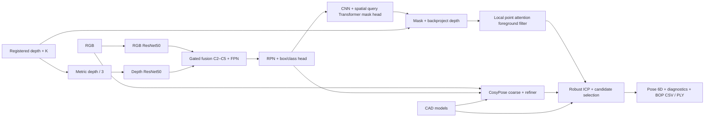

# YCBPose: RGB-D fusion, query mask head và point refinement

Ba module học mới chạy trong cùng pipeline, với inference không dùng GT mask/pose. GT visible masks chỉ cấp nhãn khi train và tính metric sau inference. Pose networks giữ nguyên pretrained CosyPose; nhánh point network được train từ đầu.



## Segmentation và ablation

`src/clutterpick/models/fusion.py` khởi tạo từ detector công khai, strict load 21 lớp + background. Mọi biến thể dùng cùng scalar depth, cùng tập ảnh, seed, minibatch budget và ROI sampler. RGB trunk được freeze. Heads được train; early fusion train stem, hai nhánh train depth layer4 và fusion adapters.

| Biến thể | Input và fusion | Mask |
|---|---|---|
| rgb | RGB | Mask R-CNN 28×28 |
| early | RGB + depth, 4 channels | 28×28 |
| late | RGB/depth FPN riêng, concat + 1×1 projection | 28×28 |
| gated | Depth/RGB C2–C5, sigmoid gate trước FPN | 28×28 |
| rgb_query | RGB | CNN + query decoder 56×56 |
| gated_query | Gated RGB-D | CNN + query decoder 56×56 |

Depth branch nhận ba kênh scalar lặp để dùng initialization RGB. Depth không hợp lệ bằng 0. Availability gate ở late/gated bỏ đóng góp depth tại vị trí mất depth; đầu vào early được khởi tạo weight kênh thứ tư bằng 0. Train có whole-modality dropout 20%, pixel dropout 10%, Gaussian noise 2 mm, áp dụng cùng lịch augmentation giữa các biến thể.

Query head dùng ROI pooling 28×28, 784 spatial queries, latent 64, một Transformer decoder bốn attention heads và residual class logits. CNN predictor xuất 56×56; residual logits khởi tạo bằng 0. Đây là kiến trúc tự triển khai, không phải PointRend. So sánh head thay cả resolution và decoder, vì vậy chưa tách riêng đóng góp attention với resolution.

Boundary AP dùng COCO evaluator với `min(mask IoU, boundary IoU)`, inner boundary width bằng 2% image diagonal. Xem [implementation tham chiếu Boundary IoU](https://github.com/bowenc0221/boundary-iou-api). Báo cáo giữ cả mask AP, boundary AP, per-class AP và pose recall; không giả định module mới luôn cải thiện.

## Learned point refinement

`src/clutterpick/models/point_network.py` nhận chín features: XYZ local normalized, RGB, membership của predicted mask, absolute depth và local neighbor distance. Model có MLP, local attention trên 16 neighbors, global pooled context và object-class embedding. Đây là mạng point-attention nhỏ tự triển khai, không phải bản tái lập đầy đủ PointTransformer hay PointNet++.

Cache train dùng RGB detector dự đoán trên PBR, ghép proposal cùng class với visible GT mask (IoU ≥0.3), dilate proposal 5 px, backproject và sample 512 points. GT projected mask tạo nhãn foreground/background. Cache này là các matched proposals; F1 không tương đương accuracy toàn scene hoặc nhãn 3D volume.

Network train weighted BCE, 20 epochs; checkpoint và probability threshold chọn bằng validation F1. Inference sample tối đa 512 points và nội suy 3-neighbor probabilities về cloud. Filter chạy trước ICP; fallback giữ cloud gốc nếu dưới 40 points hoặc dưới 25% cloud. Không dùng GT để quyết định fallback.

Contamination phải đọc cùng foreground retention và ADD(-S). Lọc bỏ nhiều points có thể giảm contamination nhưng cũng mất bề mặt cần cho pose. Đối chứng 3D dùng cùng published RGB detector và robust ICP, chỉ thay learned filter.

## Dữ liệu và protocol

`configs/research.yaml` dùng index riêng, không thay index baseline 900 test frames. Subset PBR gồm 300 train frames thuộc 10 scenes, 60 validation thuộc ba scenes và 60 holdout thuộc ba scenes khác. Downloader lấy từng ZIP member qua HTTP ranges, kiểm CRC và ghi SHA256 từng file; không xác minh hash của toàn archive 21 GB vì không tải toàn archive.

Published detector/CosyPose đã pretrained SYNT+REAL, có thể đã gặp các PBR scenes. Scene holdout ở đây độc lập với training module/fine-tuning mới, không phải toàn pretrained pipeline chưa từng thấy dữ liệu.

Segmentation train bốn epochs mỗi biến thể. Checkpoint chọn val mask AP; test chỉ scoring. Thí nghiệm cố định 96 ảnh test thật trên 12 scenes và 24 ảnh cho pose. Stress tests dùng toàn depth missing, dropout 30%/80%, noise 5 mm. Chúng làm hỏng depth đầu vào segmentation; pose stress riêng chưa được đo. Kết quả subset không thay thế benchmark baseline full 900 frames hoặc official BOP AR.

## Chạy và đầu ra

```powershell
# Chuẩn bị subset một lần; không cần tải toàn bộ train_pbr archive
.\.venv\Scripts\python.exe scripts/data/prepare_pbr_subset.py
# Train, evaluation, report, validation
powershell -ExecutionPolicy Bypass -File scripts/workflows/run_research.ps1
# Inference đủ cả ba module sau khi checkpoint đã train
.\.venv\Scripts\python.exe main.py --config configs/hybrid.yaml infer --frame-key ycbv_test/000048/1074 --output artifacts/ycbv/hybrid_demo
# Đối chứng giữ detector pretrained, chỉ bật learned point filter + robust ICP
.\.venv\Scripts\python.exe main.py --config configs/point_refined.yaml infer --frame-key ycbv_test/000048/1074 --output artifacts/ycbv/point_refined_demo
# Registered RGB-D riêng: thêm --config configs/hybrid.yaml vào infer_rgbd.py
```

`reports/ycbv/research/RESULTS_VI.md` chứa bảng đo thực tế. `fusion_training.json`, `point_holdout.json`, `point_real_comparison.json`, `ablation.json` lưu raw metrics; `delivery_validation.json` và `artifact_manifest.json` kiểm split, pose units, SO(3), provenance và hashes checkpoint/source.

PLY từng instance dùng points sau learned filter khi module được bật. Scene `point_instance_ids.npy` và `instances_pointcloud.ply` vẫn là labels chiếu từ masks 2D trước filter; provenance JSON ghi rõ nguồn này. Viewer đọc per-instance PLY đã lọc.

Các script train skip các segmentation variants đã đủ epochs. Variant đang train dở chưa resume optimizer: nếu bị ngắt, variant đó sẽ train lại từ đầu. Dữ liệu, model và report baseline được giữ nguyên.
