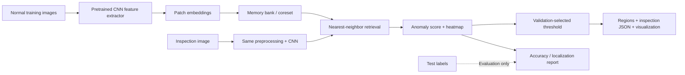

# Hướng dự án mới: Industrial Visual Anomaly Inspection

**Đề xuất này đã được rút lại:** người dùng xác nhận giữ YCBPose và cải thiện kiến trúc suy luận của project hiện tại. Không tạo project anomaly inspection.

Ngày lựa chọn: 2026-10-13. Dừng mở rộng/huấn luyện hướng RGB-D fusion, query mask head và learned point refinement. Giữ code, checkpoints và báo cáo YCBPose làm lịch sử thí nghiệm; không xóa dữ liệu hoặc thay kết quả đã đo.

## Quyết định

Chọn phát hiện và định vị bất thường trong kiểm tra sản phẩm công nghiệp: ảnh sản phẩm → anomaly score → heatmap → vùng nghi lỗi → báo cáo kiểm tra. Dùng MVTec AD và PatchCore làm baseline. Đóng góp của dự án là pipeline tái lập, đánh giá và tối ưu có đối chứng; không nhận PatchCore hoặc coreset sampling là thuật toán mới do mình phát minh.

Nguồn chính thức:

- [MVTec AD](https://www.mvtec.com/research-teaching/datasets/mvtec-ad): hơn 5.000 ảnh, 15 nhóm vật thể/texture, train ảnh không lỗi và test có/không lỗi; có pixel annotations cho lỗi.
- [PatchCore official implementation](https://github.com/amazon-science/patchcore-inspection).
- [PatchCore paper](https://arxiv.org/abs/2106.08265). Điểm báo cáo của paper không phải kết quả của dự án mới.

## Vì sao ưu tiên hướng này

Nhãn phù hợp trực tiếp với bài toán; không cần CAD, pose renderer hoặc đăng ký RGB-D. Có thể bắt đầu với một vài categories và mở rộng đến đủ 15. GPU 8 GB có thể dùng inference feature extractor theo minibatch và lưu/search memory bank theo chunks; phải kiểm peak memory trước khi chọn resolution và batch size.

Baseline có paper và source công khai. Train chủ yếu xây memory bank từ features ảnh normal nên tránh phụ thuộc vào việc fine-tune một mạng lớn trên tập ảnh tổng hợp nhỏ. Đây là đánh giá tính khả thi, không cam kết đạt điểm của paper hoặc mọi tối ưu đều có lợi.

## Achievement cần tạo

| Phần | Công việc của dự án | Bằng chứng cần xuất |
|---|---|---|
| Accuracy | Reproduce baseline theo category, split rõ ràng | Image AUROC/AP, pixel AUROC/AP, AUPRO nếu implementation được đối chiếu |
| Efficiency | Coreset budget, FP32/FP16 memory storage và exact nearest-neighbor search theo chunks | Latency p50/p95, throughput, RAM/VRAM, kích thước memory bank, độ lệch score/metric |
| Reliability | Chọn threshold bằng normal validation, kiểm robustness với blur/lighting | FPR trên normal test, defect recall, stress-test curves |
| Delivery | CLI/batch inspection, heatmaps, regions, model/config manifests và demo | Lệnh tái lập, báo cáo theo ảnh/category, tests, screenshots/video |

Coreset và mixed precision là kỹ thuật đã có. Thành tích CV có thể là mức giảm thời gian/bộ nhớ đo trên cùng máy với mức giảm chất lượng được công bố; không bắt buộc tuyên bố thuật toán mới hoặc SOTA.

## Protocol bắt buộc

1. Ghim nguồn, version và hashes dataset/model. Kiểm license trước khi dùng ngoài phạm vi nghiên cứu; MVTec AD dùng CC BY-NC-SA 4.0.
2. Train memory bank từ normal train. Giữ normal validation riêng theo seed; không dùng test để chọn resolution, memory budget hoặc threshold.
3. Làm baseline chạy đúng trước: bắt đầu bottle, capsule và cable như smoke/pilot, rồi đánh giá đủ 15 categories. Phải ghi rõ subset khi chưa chạy toàn bộ.
4. Baseline và optimized variants dùng cùng ảnh, preprocessing, features và cohort. So sánh exact FP32 với các thay đổi từng bước; không gộp nhiều thay đổi rồi quy cải thiện cho một module.
5. Đo warm latency với CUDA synchronization; tách model initialization, preprocessing, feature extraction và retrieval. Báo p50/p95 và peak allocated memory, không chỉ FPS một ảnh.
6. Image AUROC không tương đương accuracy vận hành. Báo AP, FPR/recall tại threshold đã chọn và localization metrics; giữ cả failure cases.
7. Chỉ ghi achievement khi đã có report máy đọc được và validator. Không lấy con số paper làm kết quả tự thực hiện.

## Pipeline và đầu ra

Repo mới dự kiến: `D:/Github/industrial-anomaly-inspection`, tách biệt với YCBPose. Chưa tạo dataset, chưa train và chưa có kết quả của repo mới ở thời điểm lập tài liệu này.

## Mốc và điều kiện tiếp tục

- Mốc 1: audit và reproduce baseline pilot. Nếu baseline thấp, sửa implementation/protocol trước khi tối ưu.
- Mốc 2: baseline đủ 15 categories và benchmark inference trên máy hiện có.
- Mốc 3: thí nghiệm speed/memory–quality trade-off. Chọn cấu hình bằng validation; test dùng đánh giá cuối.
- Mốc 4: demo kiểm tra ảnh, reports và CV bullet có số đo.

Mục tiêu thử nghiệm ban đầu: tìm cấu hình giảm p95 latency hoặc peak memory rõ ràng, với quality degradation nhỏ được báo cáo. Chưa đặt thành tích đạt sẵn như “2× faster” hay “99% AUROC”.

## Mẫu achievement CV sau khi có kết quả

> Built an industrial visual anomaly inspection pipeline evaluated on 15 MVTec AD categories; achieved **[measured image AUROC/AP and pixel AP]**, reduced **[measured p95 latency / peak memory]** by **[measured percentage]** against an exact FP32 baseline, and delivered reproducible benchmarks and defect-localization demos.

Các placeholder chỉ được điền bằng báo cáo của project. Nếu optimized variant không cải thiện, báo cáo baseline/demo có giá trị nhưng không ghi thành tích giảm latency/VRAM chưa đạt.

## Các hướng đã cân nhắc

| Hướng | Lợi ích | Điểm bất lợi với tình trạng hiện tại |
|---|---|---|
| Industrial anomaly inspection | Dataset đúng nhãn; baseline công khai; đo chất lượng, tốc độ, bộ nhớ; demo ứng dụng rõ | Baseline mạnh nên khó tăng AUROC; tập trung trade-off và reliability |
| Temporal RGB-D pose tracking | Tái dùng CAD/pose code; có thể đo jitter, latency và recovery | 900 BOP19 frames hiện tại là subset đánh giá, chưa đủ một benchmark video liên tiếp; cần kiểm dữ liệu camera motion và drift |
| Đổi sang pretrained novel-object pose model | Mở rộng object identities và demo pose | Chỉ đổi model ít tạo đóng góp riêng; thêm phụ thuộc renderer/CUDA, chưa bảo đảm improvement trên máy này |

Hướng anomaly inspection được ưu tiên vì bài toán và protocol có thể xác định rõ trước khi viết model mới. Lựa chọn này chưa phải cam kết về kết quả benchmark.
