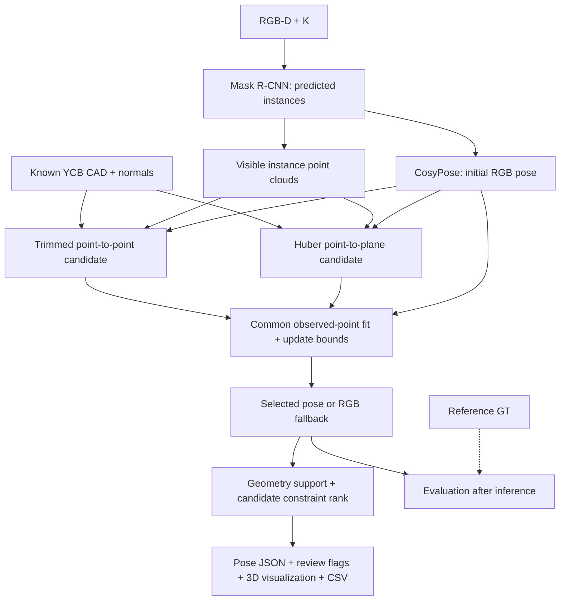

# Robust depth refinement và quality diagnostics

## Phạm vi

Mở rộng có kiểm chứng cho YCBPose: tối ưu pose cục bộ bằng depth/CAD, phát hiện geometry yếu và so sánh với baseline trên cùng predictions. Không train thêm neural network, không tải thêm dataset lớn. Kết quả thực tế: [extension/RESULTS_VI.md](../reports/ycbv/extension/RESULTS_VI.md).

## Thuật toán



1. Lấy predicted instance mask, backproject depth, lọc nhiễu và voxel như baseline.
2. Bắt đầu từ RGB neural pose đã dự đoán. Sample observed points xác định theo object ID/seed.
3. Tạo hai depth candidates: trimmed point-to-point ICP cũ và Huber point-to-plane ICP mới.
4. Point-to-plane dùng CAD surface normals, correspondence gate 40 mm, residual Huber delta 4 mm, damping 0.01. Pose update được viết trong SE(3), rotation quanh object center; giới hạn mỗi bước xoay 2° và dịch 10 mm.
5. Đánh giá candidates bằng cùng observed points, cùng trimmed Euclidean RMSE 80%. Candidate phải giảm RMSE >=10%, translation update <50 mm, rotation update <10°. Robust candidate cần support trong 40 mm >=50% và coverage 10 mm không giảm quá 2 điểm phần trăm.
6. Chọn eligible candidate có RMSE thấp nhất; nếu không có, giữ RGB pose.

Point-to-plane và robust kernels là phương pháp đã có trong [tài liệu Open3D](https://www.open3d.org/docs/release/tutorial/pipelines/robust_kernels.html). Đóng góp dự án là implementation, tích hợp candidate selection/diagnostics và đánh giá cho pipeline YCB-V hiện tại; chưa tuyên bố thuật toán hoàn toàn mới.

## Chất lượng hình học

Mỗi pose có `pose_quality` và `refinement_diagnostics`:

- `supported_geometry`: >=40 observed points, coverage trong 10 mm >=65%, trimmed RMSE <=10 mm.
- `weak_geometry`: có depth nhưng thiếu geometric support.
- `insufficient_depth`: không đủ điểm để refinement.
- `requires_review`: true nếu geometry yếu/thiếu hoặc robust candidate báo ít hơn sáu hướng được ràng buộc. Rank này thuộc candidate point-to-plane, là dấu hiệu review bảo thủ kể cả khi candidate khác được chọn.
- `calibrated_probability=false`: các giá trị này không phải xác suất pose đúng.

Diagnostics ghi RMSE trước/sau, support, candidate được chọn, translation/rotation update và information eigenvalues của point-to-plane. Planar observations có thể không đủ sáu hướng quan sát; symmetry hoặc sai identity vẫn có thể tạo fit thấp. Supported geometry không chứng nhận orientation duy nhất hay robot safety. Hệ thống xuất pose kèm cờ review, chưa tự loại pose khỏi CSV.

## Quy trình so sánh

Baseline 900 ảnh lưu predicted masks, scores và RGB pose trước ICP. Replay dùng đúng những outputs này, tính refinement mới trước khi evaluator đọc GT poses. Detector/weights không thay đổi. Mask matching được giữ từ baseline vì masks/classes không thay đổi. So sánh paired success/gains/regressions dùng tất cả 4.125 GT trong mẫu số.

Cache chưa độc lập với các test ảnh đã quan sát trước đó. Vì vậy đây là exploratory evaluation, không phải validation RGB-D thực mới. CSV của replay có time geometry/refinement CPU, không phải end-to-end CNN latency.

## Validation tổng hợp

Dùng CAD surface samples của 21 vật thể, camera-facing normals, random rotation, depth noise 1 mm, crop theo trục ảnh 80/50/25 percentile và background ratio 0/0.25/0.5 so với số foreground points. Perturb initial translation theo Gaussian sigma 10 mm và rotation sigma 2°. Ground-truth tổng hợp chỉ dùng sinh observation và chấm lỗi; hàm refinement không nhận GT.

Seed 137: 63 cases. Seed 271: 63 cases khác, giữ nguyên config. Đây là seed holdout cho corruption simulations của cùng CAD catalog, không phải holdout object identities hoặc real scenes. Cấu hình kỹ thuật cố định, không search tham số bằng real test GT.

## Tái lập

```powershell
powershell -ExecutionPolicy Bypass -File scripts/run_extension.ps1
```

Lệnh yêu cầu baseline cache đã có tại artifacts/ycbv/benchmark_full. Cấu hình enhanced riêng tại configs/enhanced.yaml. Demo end-to-end:

```powershell
.\.venv\Scripts\python.exe scripts/run.py --config configs/enhanced.yaml infer --frame-key ycbv_test/000048/1074 --output artifacts/ycbv/extension/demo
```

RGB-D riêng dùng scripts/infer_rgbd.py với --config configs/enhanced.yaml. JSON/PLY dùng mét, CSV translation dùng mm như baseline.

