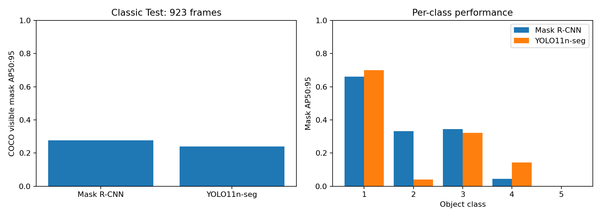

# Kết quả thực nghiệm ClutterPick

Báo cáo được tạo từ artifact thực tế; không có số liệu giả lập.

## Dữ liệu và giao thức

Classic Train chia theo scene: 1.792 ảnh train và 1.908 ảnh validation. Classic Test: 923 ảnh. Mask R-CNN chọn checkpoint bằng mask AP trên 100 ảnh validation cố định, lấy mẫu đều theo scene. YOLO dùng native validation trên 1.908 ảnh validation; test không dùng chọn checkpoint. Class 3 có validation synthetic và training real; xem per-class AP để nhận diện domain shift.

Mask R-CNN đã hoàn thành **8 epoch** trên toàn bộ 1.792 ảnh train. Checkpoint tốt nhất ở epoch 7; mask AP validation subset = 0.4707. Hai epoch đầu dùng batch 1, accumulation 2; các epoch sau dùng batch 2, accumulation 1 nếu đã resume. Effective batch vẫn là 2; lịch thực tế được ghi trong checkpoint/history.

## Detection và instance segmentation

| Model | Test frames | Box AP50:95 | Mask AP50:95 | Mask AP50 | Median detector latency (s) |
|---|---:|---:|---:|---:|---:|
| Mask R-CNN | 923 | 0.4237 | 0.2763 | 0.4802 | 0.0888 |
| YOLO11n-seg | 923 | 0.3695 | 0.2405 | 0.4038 | 0.0200 |

AP dùng confidence floor 0,05. Grasp inference dùng 0,5. Hai model có optimizer/augmentation và input size khác nhau; đây là so sánh baseline thực dụng. YOLO polygon training không biểu diễn đầy đủ mask holes, nhưng cả hai được đánh giá bằng cùng visible mask BOP gốc.

### Mask AP theo class

| Model | Obj 1 | Obj 2 | Obj 3 | Obj 4 | Obj 5 |
|---|---:|---:|---:|---:|---:|
| Mask R-CNN | 0.6606 | 0.3324 | 0.3439 | 0.0444 | 0.0001 |
| YOLO11n-seg | 0.6989 | 0.0396 | 0.3209 | 0.1433 | 0.0000 |

### Recall theo visibility

| Model | Visible 0–25% | 25–50% | 50–75% | 75–100% |
|---|---:|---:|---:|---:|
| Mask R-CNN | 0/23 (0.000) | 20/102 (0.196) | 48/146 (0.329) | 1177/1660 (0.709) |
| YOLO11n-seg | 0/23 (0.000) | 31/102 (0.304) | 37/146 (0.253) | 984/1660 (0.593) |

Recall dùng predicted mask IoU ≥0,5, cùng class và score ≥0,5; numerator/denominator được ghi để thể hiện các nhóm ít mẫu. Đây là recall theo visibility GT, không phải AP riêng từng nhóm. Khác biệt class/domain có thể ảnh hưởng kết quả cùng với occlusion.

## Downstream pose và grasp

Pipeline RGB keypoints + depth ICP đã chạy 923/923 frame Classic Test (1931 GT instances). Có candidate sau lọc ở 192 frame. End-to-end ADD recall @0,1d = 0.133; ADD-S recall @0,1d = 0.325. Median thời gian inference = 0.768 s/frame.

Thời gian này tính từ đọc RGB-D đến lọc grasp, loại reference evaluation và visualization, vẫn gồm mask export IO; benchmark bỏ PLY export để tránh ảnh hưởng lớn từ lưu point cloud. Candidate availability không phải grasp success rate.

Baseline ResNet-18 + CAD corners/PnP đã hoàn thành 12 epoch. Checkpoint chọn ở epoch 11, normalized keypoint RMSE trên validation = 0.2674. Đây không phải metric pose 6D; pose được đánh giá riêng dưới đây.

### RGB pose và RGB-D refinement

| Backend | Frames | Conditional mean frame ADD-S (mm) | End-to-end ADD recall @0.1d | ADD-S recall @0.1d |
|---|---:|---:|---:|---:|
| rgb_keypoints | 16 | 144.4 | 0.057 | 0.143 |
| rgbd_keypoints | 16 | 127.6 | 0.143 | 0.314 |

Hai cấu hình dùng cùng detector và keypoint model; khác biệt là thêm depth ICP refinement. Grasp/collision vẫn dùng depth ở cả hai. Missed detections và failed pose estimates nằm trong denominator end-to-end recall. ADD-S chỉ là chẩn đoán đối xứng gần đúng; không gọi đây là official BOP AR.

| Input geometry | Frames | Frame có candidate | Point contamination | Mean conditional frame ADD-S (mm) | Reference collision trước lọc | Sau lọc top-k |
|---|---:|---:|---:|---:|---:|---:|
| bbox | 16 | 0/16 | 62.5% | 18.7 | 100.0% | N/A |
| predicted_mask | 16 | 5/16 | 30.8% | 19.1 | 100.0% | 100.0% |
| reference_mask | 16 | 1/16 | 0.0% | 29.3 | 100.0% | 100.0% |

Pose errors là conditional trên instance mask matched; misses vẫn nằm trong số GT của summary. Reference-mask row là oracle diagnostic. Reference collision dùng GT CAD placement + observed depth sau khi planning hoàn tất; không dùng GT pose trong inference. Bộ kiểm tra vẫn dựa trên sampled surfaces và approach rời rạc, không mô phỏng vật lý.

- `bbox`: collision input 480, còn 0 candidate trước top-k; rejection rate 100.0%. Scene có candidate: 0.
- `predicted_mask`: collision input 1440, còn 9 candidate trước top-k; rejection rate 99.4%. Scene có candidate: 3.
- `reference_mask`: collision input 2320, còn 1 candidate trước top-k; rejection rate 100.0%. Scene có candidate: 1.

Trên subset predicted-mask này, reference collision rate sau lọc vẫn là **100.0%** trên 9 candidate có thể đối chiếu. Contact support cả hai điểm trong 10 mm chỉ đạt 44.4%. Bộ lọc trên pose dự đoán chưa chứng minh an toàn khi đối chiếu geometry reference. Không được dùng candidate availability để kết luận grasp chất lượng tốt, kể cả khi dùng oracle masks.

### Ảnh hưởng của detector xuống pipeline RGB-D

| Detector | Frames | ADD recall @0.1d | ADD-S recall @0.1d | Frame có candidate | Median inference (s) |
|---|---:|---:|---:|---:|---:|
| maskrcnn | 16 | 0.143 | 0.314 | 3/16 | 0.492 |
| yolo | 16 | 0.114 | 0.200 | 5/16 | 0.190 |

Hai detector chạy trên cùng frame subset cố định, cùng RGB keypoint checkpoint, depth ICP và gripper config. Đây là diagnostic trên subset nhỏ; detection AP phía trên dùng đầy đủ 923 ảnh. Timing gồm đọc dữ liệu/mask IO, loại reference evaluation và visualization; bỏ PLY export.

## Giới hạn cần trình bày

- Pipeline chính dùng RGB CAD corners/PnP và depth ICP. Backend hình học dùng CAD registration đa khởi tạo với trimmed ICP; FoundationPose adapter chưa được chạy. Partial geometry và đối xứng có thể cho residual nhỏ nhưng orientation sai.
- Render-and-compare và FPFH là backend/chẩn đoán tùy chọn đã thử trên validation samples; không mặc định coi chúng cải thiện mọi object.
- `ok` ở pose là vượt tiêu chí geometric fit, không phải xác nhận đúng GT pose. ADD/ADD-S và contact support giúp nhận diện lỗi downstream; symmetry metadata và official BOP AR chưa được xác minh đầy đủ.
- ADD/ADD-S dùng tối đa 10.000 CAD vertices lấy mẫu xác định, vì vậy là diagnostic xấp xỉ với mesh lớn; vertex counts được lưu trong từng pose diagnostic.
- Candidate không va chạm có thể không chạm đúng vật. Xem `reference_contact_supported_after_10mm_fraction`; đây cũng chỉ là chẩn đoán hình học, không phải force closure hay grasp success.
- Không có kết quả mô phỏng hoặc robot vật lý trong phiên triển khai này. Không báo grasp success rate.

## Artifact

Checkpoint: `artifacts/training/`. Metrics: `artifacts/evaluation/`. Ablations: `artifacts/experiments/ablations/`. Demo RGB-D: `artifacts/demo/classic_test_000002_149/`. Code/setup/inference: README.md. Data pixel audit: reports/local_data_audit.json.
