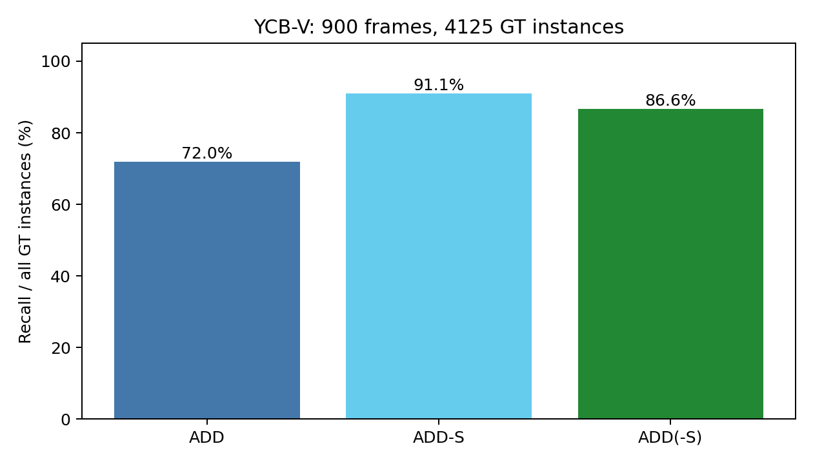
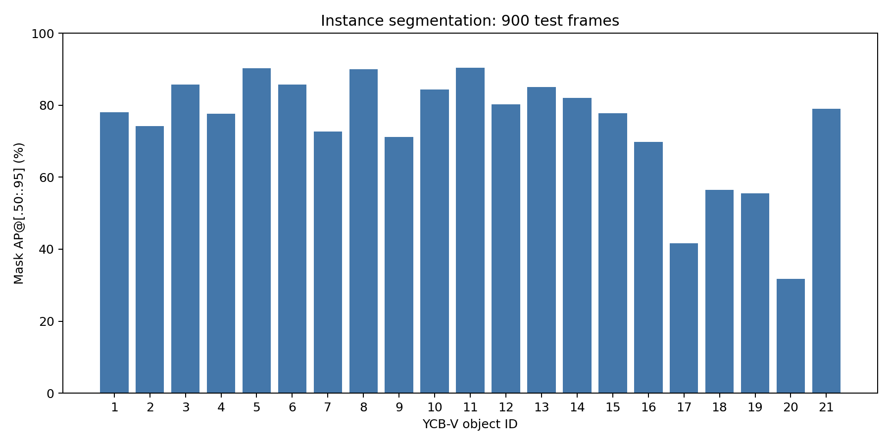

# Kết quả YCBPose

Báo cáo sinh từ artifact đo thực tế.

- Detector: 900 ảnh, 4125 GT instances.
- Bbox AP@[.50:.95]: 79.33%.
- Mask AP@[.50:.95]: 74.27%.
- Mask instance precision/recall @IoU0.5, score0.5: 95.69% / 95.76%.
- Pose: 900/900 ảnh, 4125 GT instances.
- ADD recall@0.1d: 71.98%.
- ADD-S recall@0.1d: 91.08%.
- ADD(-S) recall@0.1d: 86.59%.
- Median inference (bỏ frame đầu): 1.414 s/ảnh.

## Định nghĩa và giới hạn

ADD dùng khoảng cách các đỉnh tương ứng, ADD-S dùng láng giềng gần nhất. ADD(-S) dùng ADD-S cho lớp có metadata đối xứng, ADD cho lớp còn lại. Mẫu số gồm tất cả GT, kể cả detector bỏ sót. Hungarian ghép cùng lớp với mask IoU >= 0.5. Tối đa 10.000 đỉnh CAD được lấy xác định. Đây là chỉ số chẩn đoán, không phải AR chính thức BOP.

COCO AP thu prediction từ score >=0.05 để tính precision–recall curve; pipeline pose và instance recall dùng score >=0.5. Không diễn giải AP thành tỷ lệ ảnh đúng.

Pretrained CosyPose SYNT+REAL chưa fine-tune. Train/val hiện trống, test không dùng để train. Windows dùng Pyrender thay Bullet/EGL; checkpoint load strict nhưng không khẳng định tái lập chính xác điểm công bố. ICP có giới hạn cập nhật. Point cloud chỉ gồm bề mặt nhìn thấy từ depth. Không có đánh giá grasp hoặc robot thực.

Pilot lấy từ test đã được dùng kiểm tra port renderer và xác định cấu hình ICP trước benchmark toàn tập. Chưa có validation độc lập; kết quả là đánh giá implementation mang tính thăm dò, không phải holdout hoàn toàn chưa quan sát. Trọng số không được train trên test.

## Thí nghiệm cùng tập ảnh

| Phương án | Ảnh | ADD(-S) | Nhiễm point cloud | Oracle masks |
|---|---:|---:|---:|---|
| mask_rgbd | 24 | 87.27% | 3.94% | False |
| bbox_rgbd | 24 | 85.45% | 32.64% | False |
| reference_mask_rgbd | 24 | 90.00% | 0.00% | True |
| mask_rgb | 24 | 82.73% | 3.94% | False |

Nhiễm point cloud là trung bình không trọng số của tỷ lệ điểm nằm ngoài visible GT mask trên các instance ghép được. Đây là proxy dựa mask chiếu, không phải đánh giá semantic 3D đầy đủ. Mẫu không ghép được không vào trung bình này nhưng vẫn là thất bại của pose recall.

## Theo lớp

| Object ID | GT | ADD(-S) recall |
|---|---:|---:|
| 1 | 300 | 85.33% |
| 2 | 225 | 88.44% |
| 3 | 375 | 100.00% |
| 4 | 450 | 89.78% |
| 5 | 150 | 100.00% |
| 6 | 300 | 99.67% |
| 7 | 75 | 97.33% |
| 8 | 75 | 100.00% |
| 9 | 225 | 68.44% |
| 10 | 150 | 72.00% |
| 11 | 225 | 100.00% |
| 12 | 300 | 79.33% |
| 13 | 150 | 73.33% |
| 14 | 150 | 96.67% |
| 15 | 300 | 100.00% |
| 16 | 75 | 37.33% |
| 17 | 75 | 48.00% |
| 18 | 150 | 95.33% |
| 19 | 150 | 94.67% |
| 20 | 150 | 24.67% |
| 21 | 75 | 100.00% |

## Ảnh hưởng visibility

| Visible fraction | GT | ADD(-S) recall |
|---|---:|---:|
| 0_25 | 23 | 0.00% |
| 25_50 | 95 | 28.42% |
| 50_75 | 647 | 63.99% |
| 75_100 | 3360 | 93.18% |

Danh sách tối đa 40 ví dụ lỗi đầu tiên: [failure_examples.json](failure_examples.json). Đây là danh sách minh họa, không phải tỷ lệ lỗi theo phân phối. no_matched_pose bao gồm bỏ sót detector, sai class/mask matching hoặc không có pose hợp lệ.
