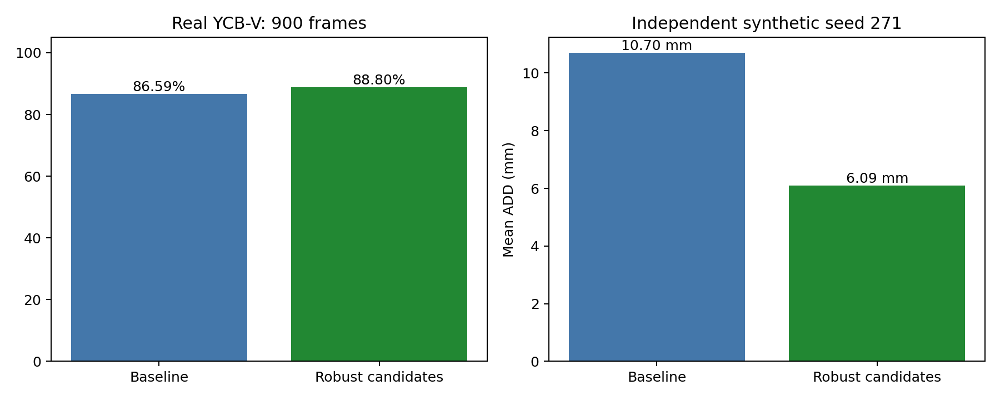

# Mở rộng YCBPose: robust depth refinement

## Thay đổi thực hiện

Bổ sung Huber point-to-plane ICP dùng CAD normals và damping cho cập nhật SE(3). So sánh candidate RGB, trimmed point-to-point và robust point-to-plane trên cùng raw observed points; chỉ chấp nhận candidate cải thiện fit và trong giới hạn cập nhật. Xuất quality diagnostics để phân biệt geometry được hỗ trợ, yếu hoặc thiếu depth. Đây là mở rộng implementation dựa phương pháp ICP đã biết, chưa tuyên bố thuật toán nghiên cứu hoàn toàn mới.

## Kết quả đo

- Real YCB-V: 900 ảnh, 4125 GT instances, cùng detector và RGB neural poses đã lưu.
- ADD(-S)@0.1d: baseline **86.59%**, enhanced **88.80%**, chênh **+2.21 điểm phần trăm**.
- Paired gains: 91; regressions: 0.
- Candidate counts: {'huber_point_to_plane': 2570, 'trimmed_point_to_point': 1053, 'rgb': 505}.



| Dữ liệu tổng hợp | Cases | Baseline mean ADD | Enhanced mean ADD |
|---|---:|---:|---:|
| Seed 137 | 63 | 8.56 mm | 6.03 mm |
| Holdout seed 271 | 63 | 10.70 mm | 6.09 mm |

Hai seed dùng cùng cấu hình kỹ thuật cố định, 21 CAD, ba mức crop/outliers, depth noise 1 mm, pose khởi tạo bị nhiễu. Không dùng real test GT trong refinement hoặc synthetic generation. Synthetic holdout không thay thế validation RGB-D thực độc lập.

## Quality diagnostics

| Nhóm | Predictions | Correct ADD(-S) | Diagnostic precision |
|---|---:|---:|---:|
| supported_geometry | 3700 | 3636 | 98.27% |
| weak_geometry | 427 | 27 | 6.32% |
| insufficient_depth | 1 | 0 | 0.00% |

| Cờ review | Predictions | Correct ADD(-S) |
|---|---:|---:|
| review | 1984 | 1568 |
| supported_and_constrained | 2144 | 2095 |

Diagnostic precision tính correct/retained predictions, bao gồm false positives là lỗi. Không phải confidence đã calibration. Symmetry hoặc sai object identity vẫn có thể khớp geometry. Pipeline giữ các pose và gắn requires_review; chưa tự loại khỏi CSV.

## Theo lớp

| Object | GT | Baseline ADD(-S) | Enhanced ADD(-S) |
|---|---:|---:|---:|
| 1 | 300 | 85.33% | 87.33% |
| 2 | 225 | 88.44% | 88.44% |
| 3 | 375 | 100.00% | 100.00% |
| 4 | 450 | 89.78% | 94.67% |
| 5 | 150 | 100.00% | 100.00% |
| 6 | 300 | 99.67% | 100.00% |
| 7 | 75 | 97.33% | 97.33% |
| 8 | 75 | 100.00% | 100.00% |
| 9 | 225 | 68.44% | 70.22% |
| 10 | 150 | 72.00% | 94.00% |
| 11 | 225 | 100.00% | 100.00% |
| 12 | 300 | 79.33% | 80.00% |
| 13 | 150 | 73.33% | 73.33% |
| 14 | 150 | 96.67% | 100.00% |
| 15 | 300 | 100.00% | 100.00% |
| 16 | 75 | 37.33% | 37.33% |
| 17 | 75 | 48.00% | 64.00% |
| 18 | 150 | 95.33% | 98.67% |
| 19 | 150 | 94.67% | 95.33% |
| 20 | 150 | 24.67% | 24.67% |
| 21 | 75 | 100.00% | 100.00% |

## Chạy lại

```powershell
.\.venv\Scripts\python.exe scripts/run.py --config configs/enhanced.yaml infer --frame-key ycbv_test/000048/1074 --output artifacts/ycbv/extension/demo
powershell -ExecutionPolicy Bypass -File scripts/run_extension.ps1
```

## Giới hạn đánh giá

Real comparison dùng cache predictions của benchmark đã quan sát, không phải validation riêng. GT chỉ dùng scoring sau prediction. Giữ metric ADD/ADD-S/ADD(-S) chẩn đoán, chưa có official BOP AR. CSV time của replay chỉ là geometry/refinement CPU, không so trực tiếp với latency end-to-end baseline. Cấu hình mới nằm configs/enhanced.yaml; configs/default.yaml tái lập baseline.
