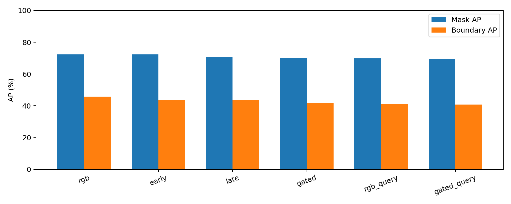

# YCBPose: ba nhánh học mới

## Phạm vi triển khai

1. RGB-only, early fusion 4 channels, late two-branch FPN fusion và gated mid-level fusion. Depth là cùng scalar metric depth, nhánh depth ba kênh lặp scalar để tái dùng CNN RGB initialization. RGB trunk frozen, depth layer4/head/adapters được train; early fusion adapt stem bốn kênh.
2. CNN mask pooling 28×28 + lightweight spatial-query transformer decoder, output masks 56×56. Đây là query-based head tự triển khai, không phải bản PointRend chính thức. Comparison thay đồng thời resolution và decoder, chưa tách riêng tác dụng attention với resolution.
3. Class-conditioned local point-attention network, predict foreground/background từng điểm trong ROI; filter trước robust ICP. Nhãn point lấy từ visible GT masks backproject vào RGB-D, không có full-volume 3D labels.

## Dữ liệu và protocol

300 PBR train frames, 60 validation frames, 60 held-out PBR frames, tách scene. 420 frames subset được tải HTTP ranges, verified ZIP CRC/member SHA256. SHA256 archive toàn bộ được ghi expected nhưng không verified vì không tải archive 21 GB. Published CosyPose pretraining có thể đã dùng các PBR scenes; holdout chỉ độc lập với fine-tuning/module training mới, không phải holdout chưa từng được toàn bộ pretrained pipeline nhìn thấy.

Checkpoint/threshold chọn bằng validation; real test chỉ dùng scoring. Real test cohort cố định 96 ảnh, pose cohort 24 ảnh trên 12 scenes. Không trộn với kết quả full 900 ảnh baseline. Train budget giống nhau: bốn epochs, 300 frames mỗi variant. Depth modality dropout 20%, pixel dropout 10%, noise sigma 2 mm khi train.

## Checkpoint chọn trên validation

| Variant | Best epoch | Val mask AP | Val boundary AP |
|---|---:|---:|---:|
| rgb | 1 | 74.28% | 61.10% |
| early | 2 | 74.47% | 61.70% |
| late | 1 | 73.97% | 60.62% |
| gated | 2 | 73.76% | 60.50% |
| rgb_query | 1 | 74.99% | 62.71% |
| gated_query | 2 | 74.21% | 61.72% |

## Mask và pose trên test cohort

| Variant | Mask AP | Boundary AP | ADD(-S), 24 ảnh | Contamination |
|---|---:|---:|---:|---:|
| Published RGB detector | 74.24% | 47.24% | 88.18% | 3.94% |
| rgb | 72.34% | 45.74% | 87.27% | 4.22% |
| early | 72.36% | 43.89% | 89.09% | 4.06% |
| late | 70.92% | 43.63% | 88.18% | 4.29% |
| gated | 70.11% | 41.93% | 89.09% | 3.80% |
| rgb_query | 69.91% | 41.40% | 89.09% | 4.49% |
| gated_query | 69.66% | 40.83% | 87.27% | 4.13% |



## Robustness depth

| Variant | Clean AP | All missing | Drop 30% | Drop 80% | Noise 5 mm |
|---|---:|---:|---:|---:|---:|
| rgb | 72.34% | 72.34% | 72.34% | 72.34% | 72.34% |
| early | 72.36% | 72.47% | 72.36% | 72.43% | 72.36% |
| late | 70.92% | 70.51% | 70.52% | 70.54% | 70.87% |
| gated | 70.11% | 70.10% | 70.14% | 70.00% | 70.10% |

## Các lớp mảnh / nhỏ

Subset cho power drill (15), wood block (16), scissors (17), markers (18), clamps (19/20). Mỗi ô là Mask AP / Boundary AP / pose ADD(-S) / contamination. Số GT pose nhỏ cần đọc như pilot.

| Object ID | GT pose | rgb | early | late | gated | rgb_query | gated_query |
|---|---:|---:|---:|---:|---:|---:|---:|
| 15 | 8 | 76.5% / 40.1% / 100.0% / 3.5% | 74.7% / 37.0% / 100.0% / 5.4% | 74.0% / 38.7% / 100.0% / 3.5% | 71.0% / 29.5% / 100.0% / 4.9% | 75.6% / 40.3% / 100.0% / 3.6% | 73.2% / 36.9% / 100.0% / 3.6% |
| 16 | 2 | 57.7% / 32.1% / 50.0% / 2.5% | 52.7% / 27.0% / 50.0% / 1.4% | 61.1% / 35.6% / 50.0% / 3.3% | 54.2% / 28.0% / 50.0% / 1.8% | 58.3% / 31.3% / 50.0% / 2.7% | 48.2% / 20.9% / 50.0% / 1.2% |
| 17 | 2 | 47.8% / 45.9% / 50.0% / 19.8% | 47.7% / 46.5% / 50.0% / 17.8% | 46.5% / 46.4% / 50.0% / 19.0% | 41.4% / 40.7% / 50.0% / 17.3% | 45.4% / 43.0% / 50.0% / 22.3% | 39.8% / 39.4% / 50.0% / 18.7% |
| 18 | 4 | 54.9% / 54.9% / 100.0% / 12.3% | 55.5% / 55.5% / 100.0% / 10.9% | 48.6% / 48.6% / 100.0% / 13.3% | 55.8% / 55.8% / 100.0% / 15.0% | 48.6% / 48.6% / 100.0% / 16.7% | 52.4% / 52.4% / 100.0% / 15.6% |
| 19 | 4 | 41.1% / 27.4% / 100.0% / 12.6% | 56.8% / 36.7% / 100.0% / 12.3% | 38.8% / 24.2% / 100.0% / 11.0% | 42.9% / 28.0% / 100.0% / 11.4% | 39.8% / 23.5% / 100.0% / 13.4% | 48.0% / 31.2% / 100.0% / 12.4% |
| 20 | 4 | 24.4% / 11.6% / 25.0% / 19.6% | 34.7% / 12.6% / 25.0% / 16.1% | 24.8% / 14.5% / 25.0% / 23.1% | 19.1% / 5.2% / 25.0% / 19.1% | 20.6% / 7.8% / 25.0% / 20.2% | 24.8% / 9.0% / 25.0% / 22.6% |

## Mạng 3D

- PBR holdout: 882 matched ROI examples; fixed threshold 0.3.
- Foreground precision 96.15%, recall 96.22%, F1 96.18%.
- Các chỉ số point là trên proposals ghép được, không phải scene-level segmentation accuracy.

| PBR held-out ROI classifier | Precision | Recall | F1 | Contamination |
|---|---:|---:|---:|---:|
| all_dilated_roi_points | 65.90% | 100.00% | 79.45% | 34.10% |
| predicted_mask_membership | 89.34% | 92.82% | 91.04% | 10.66% |
| learned point network | 96.15% | 96.22% | 96.18% | 3.85% |

| Pipeline (cùng RGB detector và robust ICP) | Contamination | ADD(-S), 24 ảnh |
|---|---:|---:|
| Không learned filter | 3.94% | 88.18% |
| Có learned 3D filter | 3.16% | 88.18% |

Mean foreground retention theo GT projection: 94.79%. Tính trên matched baseline instances, trường hợp mất matching được tính 0.

Paired ADD(-S)@0.1d: 0 fail→pass, 0 pass→fail. Đây là crossing tại ngưỡng, không phải mọi numerical pose error.

## Pipeline đủ cả ba module

Gated RGB-D + query mask head + learned point filter + robust ICP: ADD(-S) 88.18% trên 24 ảnh / 110 GT; contamination 3.36%.

Demo tại `artifacts/ycbv/research/demo/ycbv_test_000048_1074`: RGB overlays, PLY instance clouds/CAD, JSON pose và BOP CSV. Viewer HTML được tạo bằng `visualize_instances.py`.

## Cách đọc và giới hạn

Không khẳng định mọi module đều cải thiện mọi metric: bảng giữ cả kết quả giảm. Boundary AP dùng min(mask IoU, inner-boundary IoU) với boundary width 2% image diagonal theo protocol [Boundary IoU](https://github.com/bowenc0221/boundary-iou-api). Contamination là trung bình per matched instance từ point projection vào visible GT mask; chưa phản ánh mọi depth misregistration. Pose là ADD(-S) chẩn đoán, không phải official BOP AR.

Point cleaner có fallback nếu giữ dưới 40 points hoặc dưới 25% cloud. Tỷ lệ contamination thấp cần đọc cùng foreground retention/pose recall; filter mạnh có thể bỏ mất điểm đúng. Chưa có benchmark camera mới hoặc đánh giá robot.

## Chạy lại

```powershell
powershell -ExecutionPolicy Bypass -File scripts/run_research.ps1
```

## Nhận xét từ số đo

- Mask AP cao nhất trong sáu biến thể: early 72.36%; published detector cùng cohort 74.24%. Đây là mô tả test, không dùng để chọn epoch.
- RGB query head so với RGB head thường: mask AP -2.43 pp, boundary AP -4.35 pp.
- Learned filter với cùng published detector: ADD(-S) +0.00 pp.
- Train budget nhỏ và chỉ PBR có thể gây domain gap / forgetting với ảnh thật; thí nghiệm này chưa xác định nguyên nhân riêng biệt. Kiến trúc đã triển khai và đo được; chưa đủ chứng minh mọi nhánh nâng cấp tốt hơn pretrained baseline.

## Registered RGB-D không nhãn

External CLI đã chạy đủ ba module với GT count = 0, xuất pose hợp lệ. Masks và per-instance filtered clouds trùng với lần chạy có reference labels; GT không được cung cấp vào external CLI.

Pose giữa hai processes có chênh lệch tối đa 0.006 mm / 0.010°. Không khẳng định pose bitwise-equivalent hoặc quy chênh lệch này thành tác động của GT. Xem `external_input_validation.json`.

Lần kiểm tra đầu với tolerance elementwise 1e-5 không đạt: đã quan sát tối đa 1.152 mm / 0.941°. Các giá trị nhỏ hơn ở lần chạy lại không thay thế chênh lệch đã quan sát ban đầu.
